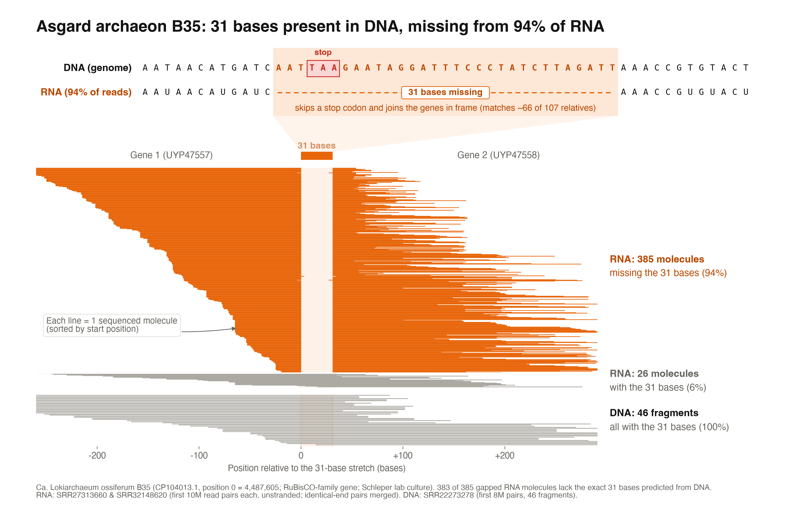

# Early evidence that mRNA introns in Asgard and TACK archaea may be more widespread than we thought

Eukaryotes splice introns out of mRNA before building proteins. Archaea have a different splicing machinery: a protein
endonuclease (`EndA`) and ligase (`RtcB`) that cut short introns out of non-coding RNAs (tRNAs and some rRNAs) wherever
the RNA folds into a bulge-helix-bulge (BHB) hairpin shape. Inside archaeal protein-coding regions, however, only **one**
intron has been experimentally confirmed so far: the *cbf5* intron in two orders of Crenarchaeota (Watanabe et al. 2002;
Yoshinari et al. 2006; reviewed in Liang et al. 2025).

Across 3,666 archaeal genomes, our agents found hundreds of short, gene-splitting stretches inside protein-coding genes
that match the archaeal BHB splicing pattern — enriched ~30× above chance in **Asgard** archaea and ~27× above chance
in **TACK** archaea, against no excess (`0.93×`) in **Euryarchaeota**. Almost none of those genomic candidates has
public RNA coverage yet. In the two cultured archaea with public RNA covering a candidate site — the Asgard archaeon
*Candidatus* Lokiarchaeum ossiferum B35 (Schleper lab enrichment culture) and the TACK archaeon *Candidatus*
Methanosuratincola verstraetei LCB70 (Hatzenpichler lab enrichment culture) — the short stretch is present in DNA but
missing from ~90% of RNA molecules, restoring the uninterrupted protein-coding gene seen in related archaea.

**This is an observation and testable hypothesis, not proof of splicing.** All public RNA libraries used reverse
transcription, and all available DNA samples predate the RNA samples. Two non-splicing explanations remain open for
both cultures: (1) a sequence-specific reverse-transcriptase (RT) skip during library preparation, or (2) a DNA
deletion lineage that arose in culture after the earlier DNA was sequenced. Complete, primer-ready experimental test
plans to settle both are included under [`experimental-tests/`](experimental-tests/).

*Asgard archaeon* Ca. *Lokiarchaeum ossiferum B35 (`CP104013.1`, RuBisCO-family gene; Schleper lab enrichment culture).
Top: DNA vs. RNA sequence across the 31-base stretch (`AATTAAGAATAGGATTTCCCTATCTTAGATT`), which holds the `TAA` stop
codon of annotated gene `UYP47557`; removing it joins `UYP47557` and `UYP47558` in frame into one 441-aa protein encoded
without a break by ~66 of 107 other Asgard genomes. Bottom: 385 of 411 RNA molecules (94%) lack the 31 bases (383 at the
exact predicted site), 26 read through (6%), and all 46 DNA fragments read through (0% lack them).*

---

- **AI-generated.** The genome scan, read analyses, artefact checks, and write-ups were produced by Claude (Anthropic)
  agents, steered and curated by Ryan Xu.
- **Checked by AI, not yet by a human expert.** Analysis rules for the 3,666-genome census, B35 culture test, B35
  artefact checks, and TACK RNA scan were frozen before scoring. Separate fresh agents independently recounted raw
  reads/alignments, ran kill-checks, audited the BHB folds and covariation, and fact-checked both wet-lab packages and
  the figure (`data/checks/`). Corrections made along the way are recorded in [`notes.md`](notes.md).
- **Computational only.** Public Illumina RNA-seq cannot rule out a sequence-specific RT skip or a post-DNA culture
  deletion. Direct wet-lab tests are required (`experimental-tests/`).
- Corrections and criticism are very welcome: ryan@ryanxu.net.

### What was found

#### 1. 3,666-genome archaeal DNA census

Main-tier placed gene-splitting stretches (`15–300` bases, microhomology `k <= 3`) scored for the BHB base-pairing motif
against same-length, same-gene decoys (`data/census/genomes_main.tsv`, `data/census/group_compare.txt`):

| Supergroup | Genomes | BHB-motif hits (`cbf5` / TRUB) | Non-`cbf5` hits | Obs / Exp vs. decoys | Genomes with >= 1 hit | Protein families |
|---|---:|---:|---:|---:|---:|---:|
| **Asgard** | 400 | 373 (19) | 354 | **29.9×** | 43% | 84 |
| **TACK** | 896 | 517 (250) | 267 | **26.7×** | 41% | 37 |
| **DPANN** | 1,068 | 74 (21) | 53 | 10.7× | 6% | 13 |
| **Euryarchaeota side** | 1,302 | 32 (0) | 32 | **0.93×** | 2% | 23 |

These are DNA candidates, not proven introns. Rates vary ~20-fold across classes within Asgard and TACK (highest
non-*cbf5* rates per 1,000 loci: Jordiarchaeia 2.12, TACK CALKCG01 2.09, Hermodarchaeia 1.76, Methanomethylicia 1.14,
Lokiarchaeia 0.86). Almost none of the non-*cbf5* candidates has public RNA coverage yet.

#### 2. Asgard *Ca.* Lokiarchaeum ossiferum B35 (Schleper lab enrichment culture)

- **Site `L02` (RuBisCO-family gene, `CP104013.1:4,487,605`, 31 bases):** predicted from DNA before opening any RNA reads.
  - **RNA:** **385 of 411** molecules lack the 31 bases (383 with at least one read at the exact predicted site and
    length; **90–99%** across three public libraries from two submissions: `SRR27313660`, `SRR32148620`, `SRR32148621`).
  - **DNA:** **0 of 46** fragments (34 distinct molecules) lack the stretch (`SRR22273278`, deposited 2022).
  - **Conserved protein:** removing the 31 bases skips `UYP47557`'s `TAA` stop codon and joins `UYP47557` and `UYP47558`
    in frame into one 441-aa protein encoded without a break by ~66 of 107 other Asgard genomes and by its closest
    relative, *L. ossiferum* B-36 (95% amino-acid identity; no 31-base stretch in its genome).
  - **B35-specific caveats:** RNA-folding software (ViennaRNA) does **not** predict a standard BHB fold at `L02` (it
    passes only the relaxed sequence motif); 0 excised circles were detected in 65.7M read pairs (though B35's own 30-base
    tRNA-SeC intron also shows 0 circles in these libraries); and the public DDA proteome (`PXD059733`) detects 12
    peptides from both halves of the gene without sampling the junction peptide's precursor.
- **Second site `S859` (hypothetical protein genes `UYP44411`/`UYP44410`, 46 bases):** discovered outside the
  pre-registered test; 856 RNA molecules lack it (822 lacking / 74 through in blind recount), 0 in DNA. Unlike `L02`,
  `S859` folds into a canonical strict BHB in ViennaRNA (central-helix probability 0.71–0.76 at 37 °C), but has no
  homolog in the other 106 Asgard genomes searched.

#### 3. TACK *Ca.* Methanosuratincola verstraetei LCB70 (Hatzenpichler lab enrichment culture)

- **Site `c0` (radical SAM gene, `CP186953.1:1,089,656`, 22 bases; `PRJNA916083`):**
  - **RNA:** **45 of 51** deduplicated molecules lack the 22 bases across 9 sense-stranded libraries (lacking outnumber
    intact in all 9; 0 bases of microhomology at the junction; 80 of 81 joined alignments match the spliced sequence
    exactly).
  - **DNA:** **0 of 58** molecules lack the stretch (`SRR23044201`, collected 2021-07-20 vs. RNA dated 2023-10-10).
  - **25-species conservation and hairpin covariation:** homologous 20–33 base stretches sit at the exact same codon in
    **25 species across 9 genera** of Methanomethylicaceae (including all 9 *Methanosuratincola* species reps), each
    putting a stop codon in the unspliced frame; outside the family (Culexarchaeales, Nezhaarchaeales,
    *Methanomethylicus*) the 364-aa gene is uninterrupted. All **25 of 25** preserve the BHB central helix at the exact
    insert boundaries (and 25/25 have an unpaired 3′ bulge), and two inner-helix base pairs show compensatory double
    mutations across species (at least 4 independent double changes on the species tree; 0 of 112 decoy pairs do this).
  - **Second species (weak support):** *M. petrocarbonis* (`PRJNA992765`, different lab, different 23-base insert at the
    same site) shows 5 of 10 RNA molecules lacking the stretch (0 of 44 DNA, earlier sample), though counts are thin and
    those libraries skip an unrelated 63-base non-BHB stretch in the same gene in 2 of 33 molecules.

### Artefact checks on public data

- **Aligner / mapping artefacts:** in B35, aligner-free k-mer counts directly on raw reads reproduce the gap (`0/51`
  DNA; `285/316` and `342/349` RNA). In LCB70, independent alignment checks find 80/81 joined alignments exact at
  MAPQ 60 with 0 bases of microhomology and 0 contiguous hits across 14 Methanomethylicales genomes.
- **PCR copying errors (B35):** duplicate molecule families with >= 2 reads show **0** mixed families vs. ~13.5 expected
  under PCR-stage skipping (Poisson `P = 1.4e-6`).
- **General hairpin skipping:** equally tight folded stretches elsewhere in the same datasets do not skip — **0 of
  3,735** equally stable DNA folds in B35 lose >= 10% of reads (and no strong RNA hairpin with dG <= -7 kcal/mol loses
  > 1%), and **0 of 84** equally stable 22-base RNA folds in LCB70 (21,558 spanning reads) show any gap.
- **IS200/IS605 DNA transposase excision (LCB70):** each of the 25 genomes carries a single copy only, and 18 of 25
  (including a closed genome) have no Y1-family transposase gene anywhere; other hairpin-cutting enzymes are not
  excluded.

### Open alternatives and experimental test plans

Public data cannot settle two non-splicing explanations:
1. **A sequence-specific RT skip** caused by something unique to the RNA (such as a modification or bound protein).
2. **A DNA deletion lineage** that arose in culture after the earlier DNA sample was collected (or an excising DNA
   element).

Complete collaborator-ready protocols, controls, amplicon sizes, and checked primer sequences for both cultures are
included in [`experimental-tests/`](experimental-tests/):
- **Asgard B35 (`L02`, `S859`, controls):** [`experimental-tests/asgard-b35-l02/README.md`](experimental-tests/asgard-b35-l02/README.md) and [`sequences.txt`](experimental-tests/asgard-b35-l02/sequences.txt).
- **TACK LCB70 (`c0`):** [`experimental-tests/tack-lcb70-c0/README.md`](experimental-tests/tack-lcb70-c0/README.md) and [`sequences.txt`](experimental-tests/tack-lcb70-c0/sequences.txt).

The cheapest decisive pair in both cultures is: (a) **PCR on DNA and RNA from the same culture aliquot** (tests a
deletion lineage), and (b) **RT-PCR with two unrelated reverse transcriptases on native RNA alongside an in
vitro-transcribed unspliced RNA control, or RT-free RNase protection / direct RNA** (tests an RT skip).

### Prior work

- **Experimentally established archaeal coding-sequence intron (*cbf5*):** Watanabe et al. 2002 (*FEBS Lett* 510:27);
  Yoshinari et al. 2006 (*BBRC* 346:1024; in vitro cleavage by recombinant EndA and protein detection); Yokobori et al.
  2009 (*BMC Evol Biol* 9:198).
- **Recent review:** Liang et al. 2025 (*Microbiol Mol Biol Rev* 89:e00318-24) states that archaeal mRNAs are generally
  intron-less, naming Crenarchaeota *cbf5* (and the 5′ UTR BHB intron of *Haloferax* `HVO_1309`, Schwarz et al. 2020)
  as EndA-spliced mRNAs.
- **Unconfirmed RNA-seq / circle candidates in other archaea:** Danan et al. 2012 (*NAR* 40:3131, *Sulfolobus* circles
  with no spliced mRNA reads); Doose 2013 (`SSO1586`); Berkemer et al. 2015 (*Genomics Comput Biol* 1:e18,
  *Methanopyrus kandleri* circular RNAs).
- **Asgard introns:** Mattick et al. 2024 (bioRxiv) report self-splicing group II introns computationally in Asgard
  genomes (different splicing class); Goswami et al. 2026 (bioRxiv) survey tRNA introns in Asgard.
- **Source cultures and datasets:** Rodrigues-Oliveira et al. 2023 (*Nature* 613:332, Schleper lab *Ca.* L. ossiferum
  B35); Kohtz et al. 2024 (*Nature* 632:1118, Hatzenpichler lab *Ca.* M. verstraetei LCB70).

### Files

- [`experimental-tests/`](experimental-tests/): primer-ready wet-lab test plans and sequences for B35 and LCB70
- [`notes.md`](notes.md): the agents' full lab write-ups joined (B35 post, 3,666-genome census, B35 artefact tests, TACK RNA scan)
- [`figures/asgard_b35_l02.png`](figures/asgard_b35_l02.png): the README figure above, rebuilt from `data/asgard_b35/`
- [`data/`](data/): summary tables, molecule/read counts, fold/covariation outputs, and audit reports; see [`data/README.md`](data/README.md)
- [`src/`](src/): `check_numbers.py`, `fig_l02_public.py`, and the analysis pipelines; see [`src/README.md`](src/README.md)
