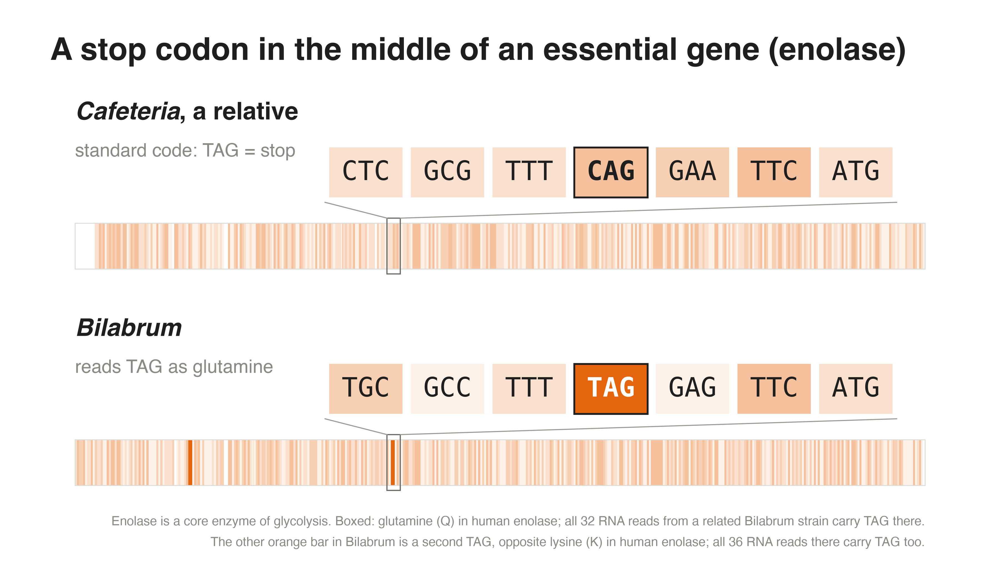

# A marine flagellate that reads the stop codon TAG as glutamine

A gene is read three bases (one codon) at a time, and it ends at a stop codon: TAA, TAG or TGA. A few eukaryotes read
one or more of the stops as an amino acid instead, mostly ciliates and a handful of other lineages, nearly all
single-celled.

***Bilabrum* cf. *latius***, a small heterotrophic marine flagellate, reads **TAG as glutamine** in its nuclear genes.
TAG sits at 166 aligned positions inside 76 conserved proteins, most often where the human protein has glutamine, and
it ends none of 149 genes checked. *Bilabrum* belongs to the stramenopiles, the large group that includes diatoms,
kelp and the potato-blight pathogen. As far as we can find, no change to the nuclear genetic code was known before in
any stramenopile.

The genome was sequenced by the Wellcome Sanger Institute's **Aquatic Symbiosis Genomics** project (GCA_965178125.1,
43 chromosomes, released March 2025), as a cobiont of the dinoflagellate *Dinothrix rugata*. It is not yet published
by the Sanger team, who may report the code themselves.

*The enolase gene of* Cafeteria *(a relative, standard code) and* Bilabrum*, aligned to human enolase. Each bar is one
codon. Boxed: a glutamine position, CAG in* Cafeteria *and TAG in* Bilabrum*; all 32 RNA reads from a related*
Bilabrum *strain carry TAG there. The second orange bar is a TAG opposite a lysine, TAG in all 36 reads.*

---

- **AI-generated.** The screen, the analysis and the write-up were done by Claude (Anthropic) agents, run and curated
  by Ryan Xu.
- **Checked by AI, not yet by a human expert.** The call rules were set on 67 genomes and transcriptomes of known
  code and frozen before the screen ran. A separate agent re-derived the TAG counts with a different aligner; two
  more fresh agents fact-checked every sentence, recomputed the numbers from the raw files and searched for prior work.
- **Not our genome.** The genome belongs to the Sanger Aquatic Symbiosis Genomics project and is unpublished. We
  thank the Sanger Tree of Life team for releasing it openly.
- **No RNA or protein from this strain.** The RNA evidence comes from a related *Bilabrum* strain (about 96%
  identical).
- Corrections and criticism are very welcome: ryan@ryanxu.net.

### What was found

76 conserved human proteins aligned to the genome with the standard code (tblastn):

| | *Bilabrum* | *Cafeteria* (same order) |
|---|---|---|
| in-frame TAG at aligned positions | 166 | none |
| in-frame TAA / TGA at aligned positions | 1 / 4 | |
| human residue at the 91 cleanest TAG sites | glutamine 44, lysine 11, no other above 5 | |
| genes ending in TAG | 0 of 149 (TGA 136, TAA 13) | 11 of 145 |

Three other bicosoecids end 35-39 of their 149-172 genes with TAG. Recount: [`src/check_numbers.py`](src/check_numbers.py).

### Evidence

- **TAG sits inside conserved genes.** TAG appears at 166 aligned positions; TAA at 1 and TGA at 4. The same test
  finds no TAG in *Cafeteria*, a relative in the same order (Bicosoecida).
- **It means glutamine.** At the 91 cleanest sites, the human protein has glutamine at 44, then lysine at 11 and no
  other amino acid at more than 5. That is the pattern of CAG, the usual glutamine codon.
- **It ends none of 149 genes checked** (TGA ends 136, TAA 13), against 11 of 145 in *Cafeteria* and 35-39 in each
  of three other bicosoecids (149-172 genes each).
- **The machinery fits.** The genome has a tRNA with anticodon CUA, which pairs with UAG; identity models score it as
  glutamine- or histidine-like, not tyrosine-like. Its eRF1, the protein that recognises stop codons, has valine at a
  serine that 2,714 of 2,776 eRF1s in UniProt reference proteomes keep and none has as valine.
- **TAG is in the RNA.** No RNA-seq exists for this genome, but a related *Bilabrum* contaminates algal cultures
  sequenced by the 1KP project (One Thousand Plant Transcriptomes). Its reads, from three of the four cultures it
  contaminates (about 96% identical to this genome), carry TAG at 41 of 60 covered sites and CAG at 18.
- **TAG behaves like a silent change.** Where this genome has CAG, the 1KP strain has TAG at 12.3 per 1,000 sites,
  close to the rate of a silent leucine change (CTG to TTG, 14.4). Comparable changes that alter the protein (His to
  Tyr, Arg to Trp, Pro to Ser) run at 0.8 per 1,000. A stop codon in a conserved gene would be weeded out like those;
  TAG is not.

### What was known

- **Nuclear stop codons read as sense** in ciliates, diplomonads and their relatives, some green algae, the
  trypanosomatid *Blastocrithidia*, a parasitic dinoflagellate (*Amoebophrya*), oxymonads and a few others. TAG
  (often with TAA) read as glutamine has arisen many times.
- **Stramenopiles.** Swart et al. 2016 screened the MMETSP transcriptomes, which include *Cafeteria*, and found no
  change outside ciliates. Some Labyrinthulea, and the Arctic *Plocamiomonas* (reported in 2026), change their code in
  mitochondria only. *Blastocystis* uses the standard code but completes some TAA stops by adding the poly(A) tail.
  NCBI lists the standard code for every *Bilabrum* taxon.
- **This TAG has been seen.** Vierock et al. 2022 (*Sci. Adv.*) found *Bilabrum* channelrhodopsins in 1KP
  transcriptomes. Some transcripts "appeared to contain premature stop codons", so they built the protein from a
  stop-free haplotype in the reads. One such stop is a TAG where that haplotype has CAG.

### Open points

- **Whether TAG still ends a few genes.** 0 of 149 does not rule out rare TAG stops, and there is no RNA or protein
  from this strain.
- **The RNA is from a related strain** (95.6-95.8% identical), not from this genome, and 58 of the 60 covered sites
  come from one 1KP run. The silent-rate comparison rests mostly on that run too (21 of the 23 CAG/TAG differences);
  the two smaller runs show TAG at about half the leucine rate (5.7 vs 10.9, 8.1 vs 15.8 per 1,000).
- **The tRNA is suggestive, not decisive.** By sequence the CUA tRNA is closest to tRNA-Tyr, and the identity models
  do not separate glutamine from histidine in this genome.
- **How far the change reaches.** Genomes of three other bicosoecid genera (*Cafeteria*, *Caecitellus*,
  *Halocafeteria*) and an unnamed relative use the standard code, so the change arose after *Bilabrum* split from
  them. Unsequenced close relatives may share it, and no other *Bilabrum* genome exists.

### What would settle it

RNA-seq or a proteome of this *Bilabrum* strain: peptides with glutamine at TAG positions, and the gene ends in the
mRNA.

### Files

- `notes.md`: the agents' full write-up (screen, evidence, checks, risks, references)
- `figures/`: the figure above
- `data/`: the per-site stop tables, gene-end tables, RNA tallies, tRNA and eRF1 files, the screen summary, and the
  check reports; see [`data/README.md`](data/README.md)
- `src/`: the code; see [`src/README.md`](src/README.md). `uv run python -I src/check_numbers.py` recounts the numbers
  above from `data/`. The figure and the per-site tables need the genomes (not included).
