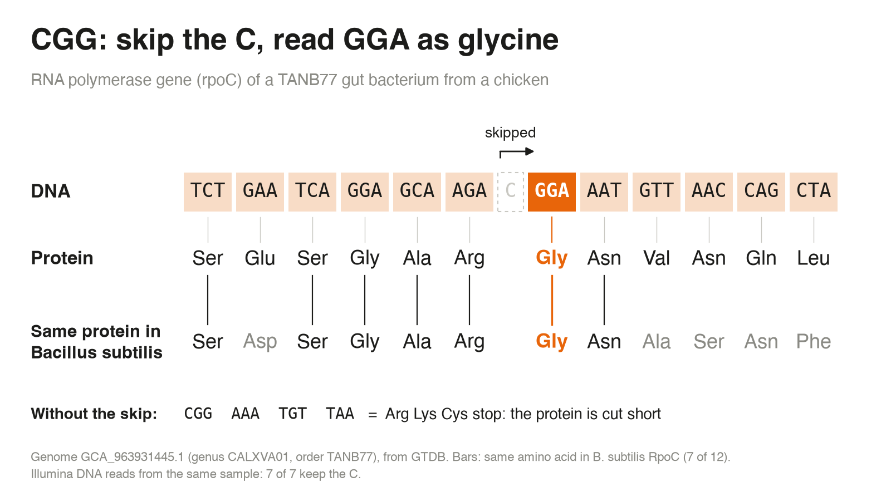

# Gut bacteria that skip the C of CGG

A gene is read three bases (one codon) at a time, each codon by a transfer RNA (tRNA) whose anticodon matches it.
Skipping a single base, a "+1 frameshift", changes every codon after it. Bacteria use programmed +1 shifts at single
sites in a few genes, the best known in the gene for release factor 2 (*prfB*). Shifts at a few recurring codons
across a whole genome were known only in nuclear genes of the ciliate *Euplotes* and in the mitochondria of
*Perkinsus*, some yeasts and glass sponges.

We aligned one genome from each of the 6,747 bacterial and archaeal families in GTDB (release R232) to known proteins,
with an aligner that allows frameshifts. In one genome of **TANB77**, an order of uncultured gut Clostridia, the shifts
piled up at the arginine codon **CGG**. Almost all TANB77 genomes have no tRNA that can read CGG, yet CGG still turns
up inside their genes. At most of these CGGs the C is passed over and the next three bases (GGN) are read as glycine,
so the rest of the gene is read one base over. RNA sequenced from pig guts keeps the C at skip sites, so the shift
most likely happens when the RNA is translated. As far as we can find, no bacterium or archaeon was known to shift
reading frame at the same codon throughout its genome.

*One real skip site, in the RNA polymerase gene* rpoC *of GCA_963931445.1 (genus CALXVA01, from a chicken caecum).
Animated version: [`figures/ribosome.gif`](figures/ribosome.gif).*

---

- **AI-generated.** The scan, the analysis and the write-up were done by Claude (Anthropic) agents, run and curated
  by Ryan Xu.
- **Checked by AI, not yet by a human expert.** Separate agents re-checked the result by different methods (a
  re-check with another aligner and other reference proteins, blind to which genomes were expected to shift; an
  aligner-free recount of the RNA reads; re-derivations of the headline numbers from the raw tables; an audit and a
  referee check of the phage counts), and several rounds of agent fact-checks went through the claims and the prior
  work.
- **Computational only.** Every TANB77 genome was assembled from mixed-community DNA (metagenomes); none has been
  grown. No protein data show the skip yet, so how often ribosomes make it is not known.
- Corrections and criticism are very welcome: ryan@ryanxu.net.

### What was found

| genomes (GTDB R232) | CGG tRNA | call the skip* | clean +1 shifts at CGG | CGG read in frame |
|---|---|---|---|---|
| TANB77, one per genus, without a CGG tRNA | none | 54 of 62 | 1,500 of 2,477† | 262† |
| TANB77, family RGIG9151 | tRNA-CCG | 0 of 2 | 0 of 8 | 139 |
| low-GC Clostridia from other orders | 44 of 50 have one | 0 of 50 | 2 of 575 | |
| CAG-698 (Bacilli_A) without a CGG tRNA | none | 0 of 7 | 1 of 33 | 271 |
| Mollicutes without a CGG tRNA | none | 0 of 7 | 0 of 28 | 276 |

\*Rule written before any TANB77 genome other than the first was scanned: at least 3 clean +1 shifts at CGG, making up
at least a quarter of all clean +1 shifts. A "clean" shift is a single +1 shift with 15 well-aligned residues on each
side, not paired with an opposite shift and not at a run of identical bases, where sequencing errors pile up.
†Over 63 genomes: the 62 genera plus a second genome of the clearest species. "In frame" counts CGGs in genes that
align with no shift.

Of 352 good-quality TANB77 species genomes, 347 have no tRNA that can read CGG (anticodon CCG or UCG). All genomes and
per-genome counts: [`data/frozen_test/`](data/frozen_test/).

### Evidence that the C is skipped and GGN read as glycine

- **The skip follows the missing tRNA.** 54 of 64 TANB77 genera call the skip, all 54 without a CGG tRNA. The 2 that
  keep tRNA-CCG (family RGIG9151) do not call. None of 50 low-GC Clostridia from other orders calls.
- **Glycine.** In related proteins, the amino acid facing the skipped C and the GGN after it is glycine at 1,237 of
  1,458 skip sites (85%), against 6% at other +1 shifts. The base after CGG follows the third-base usage of glycine
  codons (A 67%, C 5%, G 6%, T 21%, against 57%, 7%, 6% and 29% in GGN glycine codons).
- **Skips outnumber codons.** In 63 TANB77 genomes without the tRNA, 1,500 CGGs are skip sites and 262 sit in frame.
  Read straight on, the gene meets a stop codon soon after the CGG: in the clearest genome 1 to 30 codons later
  (median 10, 21 sites).
- **Not a sequencing error.** The clearest genome is a circular chromosome assembled from PacBio HiFi reads.
  Illumina reads of the same sample carry the C at all 20 of its 21 skip sites that have reads (140 reads, none
  without). Another genome of the same species, from a separate chicken study, has the C at all 20 sites it covers.
- **The messenger RNA keeps the C.** In RNA from 9 stranded pig-gut libraries (2 studies), mapped to 24 TANB77
  genomes, 305 read pairs at 69 skip sites all keep the C. So the C is not removed from the RNA before translation.
- **A blinded re-check.** A separate agent got 9 genomes without being told which ones were expected to shift (it
  knew CGG was the codon in question), and used a different aligner (miniprot) and other reference proteins. It
  called a +1 shift at CGG in exactly the 5 TANB77 genomes without a CGG tRNA (80-98% of their aligned CGGs),
  glycine in 4 of them, and standard arginine in the other 4 genomes.
- **Their phages skip CGG too.** Take the 436 human-gut phages whose CRISPR-spacer host is a skipping TANB77 genus.
  In those below 32% GC, 524 of 896 CGGs (58%) sit near a gene end where the next frame over keeps reading, against
  116 of 5,874 (2%) in phages of other Clostridia orders at the same GC. Read through the skip, the joined protein
  rebuilds a known protein domain at 239 of 600 sites, against 18 of 600 at matched gene ends without a CGG.

### What else

- **Skip sites come and go.** The *prfB* shift site is kept in 15 of 15 comparisons between relatives. Skip sites are
  not: between genera of the same family, the related genome lacks the C at 55% of skip sites (against 0.24% at
  other codon starts), and the C is kept in 41 of 43 comparisons within one species. This points to how these cells
  decode CGG, not to programmed sites in particular genes.
- **Losing the tRNA is not enough.** Some Mollicutes, some CAG-698 genomes and 6 low-GC Clostridia also lack a CGG
  tRNA. They use CGG less, but their remaining CGGs sit in frame (table above).
- **The codon before the skipped C is often CUU,** the codon before the *prfB* shift. In a test fixed in advance on
  94 other TANB77 genomes, CUU is 3.9 times as common as expected before CGGs classed as skipped (2.8 times when sites
  in related genes are counted once), and about as common as expected (1.1) before CGGs read in frame. The excess
  was first noticed after the fact, and its size and the split by family were worked out after the test: it is in
  the family CAG-508 and absent in CAG-465.
- **None in ribosomal-protein genes** (0 of 1,500 skips; exploratory). But skips do sit in essential single-copy
  genes, such as *rpoC* in the figure.

### What was known

- **CGG as glycine, in public data.** KACI ([Melnykov 2026, *PNAS*](https://doi.org/10.1073/pnas.2610659123)) infers
  genetic codes for about 2.7 million assemblies. Its public results table
  ([Zenodo](https://doi.org/10.5281/zenodo.19323489), June 2026 version) labels CGG as glycine in 941 of 2,763
  TANB77 assemblies, and every CGG = glycine call there that matches a GTDB genome is TANB77. We read these calls as
  this skip, seen by a method that assumes one reading frame. The KACI preprint does not discuss TANB77, and leaves
  "the extent of nonstandard CGG decoding and its exact meaning in Clostridia" to "a separate investigation". We
  could read only the abstract and significance statement of the *PNAS* version.
- **Codetta** ([Shulgina & Eddy 2021, *eLife*](https://doi.org/10.7554/eLife.71402)) leaves CGG undecided in 96 of
  113 TANB77 assemblies.
- **The closest case: glass-sponge mitochondria.** In *Aphrocallistes vastus* the only two UGG codons sit at +1
  shifts, where the protein continues from the overlapping GGA as a conserved glycine. The authors report that the
  RNA keeps the extra base ([Rosengarten et al. 2008](https://doi.org/10.1186/1471-2164-9-33)), and across glass
  sponges such sites appear to be gained and lost ([Haen et al. 2014](https://doi.org/10.1016/j.gene.2013.10.041)).
  That is the TANB77 skip at 2 sites. Here it is a bacterial order, with about 1,500 sites in 63 genomes.
- **Genome-wide frameshifts elsewhere.** *Euplotes* shifts +1 at stop codons in about 1 in 10 genes
  (Wang et al. 2016; [Lobanov et al. 2017](https://doi.org/10.1038/nsmb.3330)); *Perkinsus* mitochondria shift at
  AGG and CCC (Masuda et al. 2010); some yeast mitochondria at CTGY
  ([Szabóová et al. 2018](https://doi.org/10.1093/femsyr/foy028)).
- **Shifts where a tRNA is missing.** In *E. coli*, an overexpressed gene shifts +1 at tandem CGG codons, and adding
  the CGG tRNA largely stops it ([McNulty et al. 2003](https://doi.org/10.1016/s1046-5928(02)00610-1)). In
  *Mycoplasma capricolum*, which has no CGG tRNA, translation halts at CGG in a cell-free system
  (Oba et al. 1991).

### Open points

- **No protein evidence.** No public gut metaproteome we checked has enough TANB77 peptides across skip sites to
  test the skip.
- **Mechanism unknown.** The ribosome may stall at CGG and slip one base, or a tRNA may read the four bases CGGN as
  one glycine codon. Two tRNA finders find no four-base reader in the pig genomes, but a reader made by a chemical
  modification would not show in the sequence. Removal of the C from the RNA does not fit the RNA reads.
- **The RNA evidence is thin and was split after the count.** The rule fixed in advance pooled all CGGs (0 of 9,191
  read pairs lack the C), but most of those reads fall at CGGs that genes read in frame. The split into skip sites
  was made after the count. The 305 read pairs at skip sites cluster in 4 genomes, 132 of them at one site. An
  independent recount without an aligner found 278 with the C and 3 without at skip sites (3 of 281), all 3 at one
  site whose C-less version occurs in the DNA of 6 other TANB77 species, so probably reads from relatives.
- **The rule under-calls.** The blinded re-check found the shift at 13 of 14 CGGs in one genome (genus UMGS1901) that
  the frozen rule did not call, so 54 of 64 is a lower bound.

### What would settle it

Protein data. Peptides that cross skip sites, from deep metaproteomes of TANB77-rich chicken caecal content or from a
culture, would show whether CGG becomes glycine and the protein continues in the shifted frame, and how often.

### Files

- `notes.md`: the agents' full write-up (method, evidence, checks, open points, references)
- `figures/`: the skip site above, its animation, and the tRNA comparison figure in `notes.md`
- `data/`: per-genome tables of the frozen test and its controls, the per-site frameshift calls, tRNA tables, read
  and RNA tallies, the blinded re-check, the turnover and CUU tests, the phage counts, and the logged rules; see
  [`data/README.md`](data/README.md)
- `src/`, `scripts/`: the analysis, runnable with `uv run`; `scripts/setup_reference_data.sh` says how to fetch the
  genomes and databases
