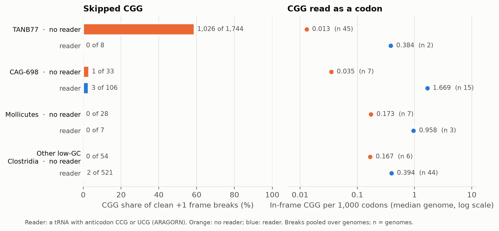

# Notes: gut bacteria that skip the C of CGG

The agents' full write-up (method, evidence, checks, open points). The short version is in [`README.md`](README.md).
Times are US Eastern, November 2026. The logged rules, with the time each was written, are in
[`data/prereg.md`](data/prereg.md).

**Summary.** Almost all bacteria of TANB77, an order of gut bacteria, have no tRNA that can read the arginine codon
CGG, yet CGG still turns up inside their genes. Comparing those genes with related proteins shows what happens at most
of them: the C is passed over, and the next three bases (GGN, where N is any base) are read as glycine. So in these
genes CGG moves the reading frame forward by one base. RNA sequenced from pig guts keeps the C at skip sites, so the
shift most likely happens when the RNA is translated. We found no earlier report of a bacterium or archaeon whose genes
shift reading frame at the same codon throughout the genome. The closest known case is in the mitochondria of glass
sponges, at one to a few sites per genome. **All evidence is computational. Every TANB77 genome is assembled from
mixed-community DNA, and no protein data show the skip yet.**

## Background
A gene is read three bases (one codon) at a time. A transfer RNA (tRNA) whose anticodon matches the codon brings in
the amino acid. Skipping a single base, a "+1 frameshift", changes every codon after it. Bacteria use programmed +1
shifts in a few single genes; the best known is in the gene for release factor 2 (*prfB*). Shifts at a few recurring
codons across a whole genome were known in nuclear genes of the ciliate *Euplotes*, and in the mitochondria of
*Perkinsus* (a parasite of oysters related to dinoflagellates), of some yeasts and of glass sponges. The glass-sponge
shift has the same shape as the one below (see "What was known").

TANB77 is an order in the class Clostridia (phylum Bacillota). GTDB, the standard bacterial taxonomy (release R232),
holds 2,765 TANB77 genomes in 64 genera. All were assembled from mixed-community DNA (metagenomes), mostly from the
guts of humans, mice, chickens, rabbits, ruminants and pigs, and none comes from a culture.

## Method
1. **Frameshift scan.** DNA-to-protein alignments that allow frame shifts (DIAMOND 2.2.8 `blastx -F 15` against
   Swiss-Prot clustered at 50% identity, prokaryote and virus clusters; `src/fs_scan.py`, `src/summarize.py`), run on
   one genome per GTDB R232 family (all 6,747 families). The pass rules were fixed on controls and planted shifts
   before any family was read ([`data/prereg.md`](data/prereg.md), section 1). The CGG skip came out of this scan as
   a flag in one TANB77 genome, GCA_963931445.1. The scan found no other frameshift code among the family
   representatives, but that negative has limited reach (a +1 code used at about 3% of genes would most likely have
   been seen in the larger genomes, one at about 10% in smaller ones; −1 codes and Nanopore-only assemblies are
   covered weakly or not at all), and its tables are not included here.
2. **A test fixed before the scan** (11 Nov 15:35, before any TANB77 genome other than the discovery genome was
   scanned): one genome per TANB77 genus (64), scanned like the family representatives. Call rule: at least 3 clean
   +1 shifts at CGG, making up at least a quarter of all clean +1 shifts. A "clean" shift is a single +1 shift with 15
   aligned residues on each side and no gaps there. It must not be paired with an opposite shift within 150 bases,
   and must not be at or within 6 bases of a run of 5 or more identical bases, where sequencing errors pile up. Four
   predictions were written down (calls, tRNA, glycine, reads; `src/analysis/cgg_test.py`). One change was logged
   after the freeze and before the read check: the reads test used the sample's Illumina run instead of the HiFi
   reads that built the assembly.
3. **Checks of the discovery genome:** raw reads, a second assembly of the same species, and a blinded re-check with
   a different aligner.
4. **Further tests,** each with its rule written before it was run: the turnover test, a test in a second lineage
   that lost the tRNA (CAG-698), the RNA test, and the replication of the CUU context. Exploratory counts are marked
   as such below.
5. **Phages** of TANB77 (human-gut phage catalogue UHGV), with rules fixed before any target statistic was computed,
   an independent audit, a referee check out of sample, and a Pfam check.

## Results

### No reader
Two tRNAs can read CGG, those with anticodon CCG or UCG. Of 352 good-quality TANB77 species genomes, 347 have neither
(ARAGORN screen of the GTDB R232 species representatives; usable = completeness ≥ 90, contamination ≤ 5, ≥ 30 tRNAs and
at least one other Arg tRNA; `data/trna/`). The other 5 have one: 3 in the family RGIG9151 (tRNA-CCG), and one each in
two genera of the family CAG-508. We scanned those two after the test below:
- the CAG-793 genome (tRNA-CCG, on a contig with ribosomal-protein genes) has almost no CGG left: 2 in frame in
  132,714 aligned codons, and no skips;
- the CAG-452 genome skips like the rest (128 of its 175 clean +1 shifts are at CGG). Its tRNA-UCG sits on a 55 kb
  contig that looks like a prophage. Only three of our reference proteins align to it: a phage lysin, a dUTPase and a
  single-strand binding protein.

### The test fixed before the scan
- 54 of the 64 genera call, and all 54 lack a CGG tRNA. The 2 that keep tRNA-CCG (RGIG9151) do not call: none of their
  8 clean +1 shifts is at CGG (one-sided Fisher P = 0.022).
- None of the 6 control genomes fixed in advance (low-GC Clostridia from outside the order) calls: 0 of their 49 clean
  +1 shifts are at CGG. Extended afterwards to 50 such genomes: none calls, and 2 of their 575 clean +1 shifts are at
  CGG.
- **Glycine.** In the related proteins, the amino acid facing the skipped CGG and the base after it is glycine at 1,237
  of 1,458 sites (85%). At other +1 shifts it is glycine 6% of the time (40 of 663). The base after CGG follows the
  usage of the third base of glycine codons: A 67%, C 5%, G 6%, T 21% after CGG, against 57%, 7%, 6% and 29% in GGN
  glycine codons.
- **Skips outnumber codons.** In 63 TANB77 genomes without a CGG tRNA (one per genus, plus a second genome of the
  clearest species), 1,500 CGGs are skip sites, while 262 sit in frame within genes that align without a shift. The
  median genome has 0.014 in-frame CGG per 1,000 codons. (The two counts come from different hit sets, broken against
  frame-continuous hits, so the ratio is descriptive, not a rate.)

Per-genome table: [`data/frozen_test/cgg_test_T.tsv`](data/frozen_test/cgg_test_T.tsv); per-site calls:
`data/scans/`.

### Reads
The clearest genome, GCA_963931445.1, is a circular chromosome assembled from PacBio HiFi reads of chicken caecal
contents. Illumina reads of the same bird's sample (ERR11860625) carry the C at all 20 of its 21 skip sites that have
reads: 140 reads with the C, none without. The 21st site has almost no reads. Another genome of the same species
(GCA_944393025.1), assembled from short reads in a separate chicken study, has the C at all 20 of the sites it covers
(`data/reads/`).

### The messenger RNA keeps the C
If the C were removed from the messenger RNA before translation, sequenced RNA would lack it. We tested this in RNA
sequenced from pig gut samples, mapped to 24 TANB77 genomes from a pig-gut genome catalogue (MGnify pig-gut v1.0). The
counting rule and pass mark were written before any read was checked for the C
([`data/rna/RULES_AND_LOG.md`](data/rna/RULES_AND_LOG.md)).
- We used only sequencing libraries that keep the strand of the RNA: 9 samples from 2 studies. In such libraries, reads
  from messenger RNA come from one strand, while leftover DNA gives both strands equally. Reads on the wrong strand are
  at most 4.6% in any library, so DNA makes up at most about 9% of TANB77 gene reads.
- The rule fixed in advance pooled all CGGs, and it passed: in our count, no read pair (the two reads sequenced from one
  RNA fragment) lacks the C, 0 of 7,498 in the 8 libraries it was written for, and 0 of 9,191 with the ninth.
- But most of those reads fall at CGGs that the genes seem to read straight through, so they say little about the skip.
  A fact-checking agent pointed this out, and after the count we sorted the CGGs by what follows them, using the
  fact-checker's test unchanged. At a **skip site** the gene's original frame reaches a stop codon within 30 codons,
  while the shifted frame runs on for at least 60, so the full protein needs the skip. At a **read-through site** it is
  the other way round. The test agrees with the alignments: of the 30 CGGs in one genome where alignments show the
  shift, 27 pass it as skip sites and none as read-through sites.
- **At skip sites.** Of the 2,871 CGGs listed before the count, 1,330 look like skip sites and 782 like read-through
  sites. Reads cover 69 skip sites, with 305 read pairs, and all 305 keep the C. They are clustered: 292 come from 4
  genomes, and one site holds 132. If even 1 RNA molecule in 50 lacked the C, about 6 of the 305 would show it.
- Read-through sites draw far more reads: 6,282 read pairs at 166 sites, all with the C. So do 2,604 at 69 sites that
  fit neither pattern, and 22,389 at 2,591 CGA, CGC and CGT codons.
- Before the count we had also listed, in one genome, the CGGs where alignments to related proteins show the shift
  directly. 17 of them are covered, by 37 read pairs, and all keep the C. 30 of these read pairs are among the 305
  above.
- A separate agent re-counted from its own download of the reads, looking for the exact bases around each site instead
  of using a mapping program. At the skip sites it found 278 read pairs with the C and 3 without, all 3 at one site
  where no read has the C. The bases there without the C occur in the DNA of 6 other TANB77 species, from 5 other
  genera, and the version with the C in none of them. So these 3 reads probably come from relatives whose gene has no
  C at that point.
- A first set of 10 libraries also had no read without the C (0 of 6,262 at CGG sites). But 9 of the 10 do not clearly
  keep the strand, and by the share of their reads from ribosomal-protein genes none of those 9 looks like RNA (5 look
  like DNA, 4 are unclear). So the result above uses only libraries that keep the strand: the one in that set, and 8
  more chosen by strand before they were counted. DNA reads from the same pigs, checked as the rule required, lack the
  C at one site in some animals (11 of 21 reads there), consistent with strains whose genome has lost that C.
- So at the skip sites covered, in a few pig-gut TANB77 strains, the C is in the messenger RNA, and the skip most
  likely happens during translation. The split into skip and read-through sites, on which that rests, was made after
  the count.

### A blinded re-check
A separate agent was given 9 genomes without being told which ones we expected to shift (it knew CGG was the codon in
question, and that a frameshift was one possible answer), and worked with a different aligner (miniprot) and different
reference proteins (8 standard-code Firmicutes isolates, with every CGG and stop residue masked). The 9 were 5 TANB77
genomes without a CGG tRNA, 1 TANB77 genome with one, and 3 other Clostridia
([`data/blinded_recheck/VERDICT.md`](data/blinded_recheck/VERDICT.md)).
- It called a +1 shift at CGG in exactly the 5. CGG was followed by a shift at 80–98% of their aligned CGG sites.
- It called the residue glycine in 4 of the 5; the fifth had too few sites to name one.
- It found standard arginine in the other 4 (one with low confidence: 26 sites).
- Its controls: it found the *prfB* shift in all 8 genomes where that gene aligned. It also found edits planted in a
  genome that has a CGG tRNA. Of 150 planted "C before a glycine codon" sites, 146 were detected and 128 were read as
  glycine. Of 100 planted "CGG plus one base" at arginine sites, 99 were detected and 84 were read as arginine.
- It found the shift at 13 of 14 CGG sites in one genome (genus UMGS1901) that our call rule did not call, so 54 of 64
  genera is a lower bound.

### The sites come and go
The *prfB* shift site is kept in 15 of 15 comparisons between relatives (7 sites). Skip sites are not. Between genera
of the same family, the related genome has a gap opposite the C in 55% of comparisons, against 0.24% at other codon
starts (the measure fixed before the run). Counting net length instead, it is one base shorter at 87%. Between two
genomes of one species, the C is kept in 41 of 43 comparisons. This suggests the skip comes from how these cells
decode CGG, not from particular genes. The test had three predictions fixed before the run. Two passed: sites are
shared within a species and lost between genera. The third (new sites gained before glycine codons at 5× the
background rate) failed at 2.3×; we worked out afterwards that the 5× bar was out of reach (`data/turnover/`).

### Losing the tRNA is not enough
Some Mollicutes (mycoplasmas and relatives) and some genomes of the family CAG-698, both in the GTDB class Bacilli_A,
also lack a CGG tRNA, as do 6 of the low-GC Clostridia controls. They use CGG less than relatives that keep the tRNA.
But their remaining CGGs sit in frame: 276, 271 and 1,303 in-frame CGGs, against 0 of 28, 1 of 33 and 0 of 54 clean +1
shifts at CGG. TANB77 genomes in the same tRNA screen have 187 in-frame CGGs, and 1,026 of their 1,744 clean +1 shifts
are at CGG. The CAG-698 test was fixed before any CAG-698 genome was scanned, and its first prediction (that losing
the reader brings skipping, as in TANB77) failed.

*Left: share of clean +1 frame shifts that fall at CGG. Right: CGG read in frame, per 1,000 codons. Each lineage is
split by whether its genomes have a tRNA that can read CGG (orange: none; blue: present). The figure counts only
genomes in the tRNA screen of GTDB species representatives, 45 for TANB77 without a reader, so its totals are smaller
than those in the text. Data: [`data/frozen_test/figure_data.tsv`](data/frozen_test/figure_data.tsv).*

### The codon before the skipped C
It is often CUU, the codon before the *prfB* shift and before the Ty1 shift. We noticed this after the fact in the
scan above: 153 times, against 26 expected from the codons that precede ordinary glycine codons. A test fixed in
advance on 94 other TANB77 genomes from chickens, with CGGs classed as skipped or read in frame by sequence alone, found
a similar excess against the same comparison (695 against 99 expected: 7.0-fold, against 6.0). A separate agent
re-derived the count and found that comparison too generous: CUU is more common before the other codons that start
with CG (CGA, CGC, CGT) than before glycine codons. Against those, CUU is 3.9 times as common as expected before CGGs
classed as skipped, and 2.8 times when sites in related genes are counted once. Before CGGs classed as read in frame
it is about as common as expected (1.1). These sizes, and the split by family, were worked out after the test. Almost
all the sites are in the family CAG-508 (4.0-fold), and the one genome of the family UBA1234 shows the excess too (12
against 3.6 expected). The family CAG-465 shows none: 1 against 3.5 expected, where CAG-508's rate would give about 14
(`data/cuu_context/`).

### Where skips sit (exploratory)
There are none of 1,500 in ribosomal-protein genes, which hold 3% of aligned residues. Other shifts are scarce there
too, but not absent: 16 of 1,189 (1.35%). Skips do occur in essential single-copy genes: in the clearest genome, one
sits in the gene for the RNA polymerase β′ subunit (*rpoC*), so the ribosome must pass it (the figure in
[`README.md`](README.md)). The denominator is aligned residues, not GGN opportunities.

### Their phages read CGG the same way
- **Data.** UHGV, a catalogue of human-gut phage genomes, links phages to hosts through CRISPR spacers (pieces of phage
  DNA a bacterium stores).
- **Main count.** The test set is 436 phages whose spacer host is a skipping TANB77 genus. Among those below 32% GC,
  524 of 896 in-frame CGGs (58%) sit near the end of a gene where the next frame over keeps reading for at least 50
  codons. That is where a skip would put them.
- **Comparisons.** In phages of other Clostridia orders at the same GC, the figure is 116 of 5,874 (2%). For nine
  related codons in the TANB77 phages (the other arginine codons, GGG, CCG, GGA and AAG) it is 0.7–3.6%.
- **Shared sites.** Many CGGs are copies of conserved sites shared across phage genera: 27 sites seen in at least 5
  viral genera hold 300 of the 832 CGGs. Counting each site once, below 32% GC (on the audit's re-called genes, 490 of
  832 CGGs), 202 of 384 distinct sites in the 436 phages are skip sites, against 57 of 3,662 in other-order phages.
  Sites found in only one viral genus give 137 of 281 against 51 of 3,072.
- **No avoidance.** The phages use CGG about as often as their composition predicts (rate ratio 1.07).
- **Read-through check.** Reading through the skip joins the two pieces into one protein. At 31 of 40 sites, that
  joined protein aligns to an uninterrupted relative across the join (against 3 of 40 at gene ends in the same phages
  that end on other codons, and 8 of 40 at the rare CGG sites of other-order phages), and the relative has glycine at
  the first residue after the join in 27 of 38 cases. The joined protein also rebuilds a known protein domain at 239
  of 600 sites, including the phages' own terminase and portal proteins. At matched gene ends without a CGG, this
  happens at 18 of 600.
- **Out-of-sample check.** Phages below 32% GC with no spacer host, whose k-mer-based host prediction is TANB77, show
  the same pattern: 20 of 50 CGGs, against 1 of 146 in GC-matched phages whose k-mer host is another Clostridia order.
  None of these phages was in the first set, but 12 of the 20 skip CGGs sit at conserved sites also seen in the first
  set. At the other sites it is 8 of 31 against 1 of 146.
- **Limits.**
  - The comparison is with other orders, not with non-skipping TANB77 genera. The two genera we called non-skippers
    rest on too few shifts to say.
  - Almost no viral genus has hosts on both sides, so the pattern is separated from phage lineage only at the family
    level. There, all 5 families with at least 30 CGGs on each side split by host (vFAM-00025 has only 8 on the
    other-order side: 2 of 8).
  - The 42 TANB77-host phages above 32% GC show no sign of it. 33 of them rest on 1–4 spacer links, and their k-mer
    host is another order for 18, Clostridia with no order given for 3, missing for 19 and TANB77 for only 2, so wrong
    host calls are the likelier reading. Against that, phages above 32% GC whose k-mer host is TANB77 also lack the
    signature (4 of 316 CGGs). Neither reading is shown.

Tables and rules: [`data/phages/`](data/phages/).

## What was known
- **CGG as glycine, in public data.** KACI (Melnykov 2026; preprint bioRxiv 10.64898/2026.04.02.715157) infers genetic
  codes for about 2.7 million genome assemblies. Its public results file (Zenodo 10.5281/zenodo.19323489, June 2026
  version) calls CGG glycine in 941 of 2,763 TANB77 assemblies, all marked by KACI as interesting. Every CGG = glycine
  call there that matches a GTDB genome is TANB77. These calls are this skip, seen by a method that assumes one reading
  frame: the skipped C plus GG lines up against glycine. KACI calls CGG arginine in all 9 assemblies of RGIG9151, the
  family that keeps tRNA-CCG, and glycine in the CAG-452 genome that skips despite its tRNA-UCG. Among bacteria, the
  only new CGG meaning the KACI preprint reports is alanine, in another Clostridia genus, RGIG3102. It says that "the
  extent of nonstandard CGG decoding and its exact meaning in Clostridia should be a subject of a separate
  investigation". It does not discuss TANB77. The *PNAS* version reports three candidate code changes. We could read
  only its abstract and significance statement. The significance statement's "sense codon reassigned to serve as
  translation stop" is, judging by the preprint, CGA in Asgard archaea. (The March 2026 file that the preprint cites
  gives 923 of 2,722, also all TANB77.)
- **Codetta** (Shulgina & Eddy 2021) leaves CGG undecided in 96 of 113 TANB77 assemblies. In other low-GC bacteria it
  predicted CGG reassigned: to glutamine in *Peptacetobacter*, and to tryptophan in a clade of the order RFN20 and in
  *Anaerococcus*. For *Anaerococcus prevotii* there is now protein evidence: a preprint posted on 12 November 2026
  reports six peptides with tryptophan at native CGG codons and none with arginine (Kim et al. 2026). It notes that no
  sense-to-sense change in a bacterium had been confirmed by experiment until then. Shulgina & Eddy also noted that
  the group including *Clostridioides difficile* appears to lack any tRNA able to read CGG, and hardly uses the codon.
- **CGG without a tRNA.** In *Mycoplasma capricolum* CGG has no tRNA and is unassigned. In a cell-free system from
  that species, translation halts at CGG instead of skipping it (Oba et al. 1991).
- **A codon with no reader, engineered.** In *E. coli* recoded so that nothing reads UAG, ribosomes at UAG misread it,
  shift frame by −3 to +19 bases, or are rescued by tmRNA (Ma et al. 2018). That is a stop codon in a lab strain, not
  a coding rule.
- **Shifts at starved codons.** Where a codon's tRNA is scarce, ribosomes can slip +1:
  - at CUU-AGG-C in the yeast retrotransposon Ty1 (Belcourt & Farabaugh 1990);
  - at tandem rare arginine codons (AGG_AGG, AGA_AGA) in *E. coli* (Gurvich et al. 2005);
  - at tandem CGG codons in a gene overexpressed in *E. coli*, where adding the CGG tRNA largely stopped the shift
    (McNulty et al. 2003). The same study found CGG misread as glutamine.
- **+1 at CGG itself.** In the CGG repeat of the human *FMR1* gene, ribosomes shift +1 from the arginine into the
  glycine frame, driven mainly by the RNA's sequence and structure (Wright et al. 2022).
- **Whole-genome frameshift codes.** *Euplotes* shifts +1 (sometimes +2) at stop codons in about 1 in 10 genes (Wang
  et al. 2016; Lobanov et al. 2017). *Perkinsus* mitochondria shift +1 or +2 at a few unused codons, including AGG and
  CCC, in all three of their genes (Masuda et al. 2010; Gornik et al. 2022). The *Perkinsus* sites are conserved in
  position, unlike the TANB77 skip sites. In the mitochondria of the yeast *Kazachstania sinensis*, three genes
  (*cox3*, *atp6*, *cob*) shift +1 at CTGT or CTGC, and such shifts are also found in some relatives, including
  *Candida glabrata*. In every species with these shifts, the cysteine tRNA has an A-to-G change at position 37, next
  to its anticodon; the authors propose that this G pairs with the skipped first C, so the four bases are read as one
  cysteine (Szabóová et al. 2018).
- **The closest case: glass-sponge mitochondria.** In the mitochondrion of the glass sponge *Aphrocallistes vastus*,
  tryptophan is coded by UGA, and the only two UGG codons sit at +1 shifts, in *cox3* and *nad6*. At both, the protein
  continues in the +1 frame from the GGA that overlaps the UGG (U-GGA), with a glycine that is conserved in related
  proteins. The authors report, without showing the data, that RT-PCR products spanning both sites, sequenced
  directly, keep the extra base, and take this to rule out RNA editing (Rosengarten et al. 2008). They proposed that
  ribosomes pause at the rarely read UGG and an abundant glycine tRNA for GGA pushes them into the new frame. Across
  glass sponges, single-base insertions at shift sites appear to have been gained and lost repeatedly, which the
  authors read as the sites having no function of their own (Haen et al. 2014). That is the TANB77 skip on a small
  scale: a codon ending in GG that the cell rarely reads, its first base passed over, the next three bases read as
  glycine, the base kept in the RNA and, across glass sponges, shift sites that come and go. What is new here is a
  bacterium, a whole order, and about 1,500 sites in 63 genomes (21 in the clearest one, against 2 in *A. vastus*).
- **Bacterial genes rescued from frameshifts.** In some insect endosymbionts, RNA polymerase slips on runs of A and so
  partly repairs broken genes (Tamas et al. 2008). That works on a base run, not a codon.
- **Reviews.** A 2025 review of natural variations of the genetic code (Lukeš et al. 2025) names *Euplotes* and
  *Perkinsus* as cases of systemic frameshifting, and no bacterial or archaeal case.
- **Lab signals before this.** The lab's earlier stop-codon screen ([`../tta-myxobacteria`](../tta-myxobacteria), Arm
  A) had flagged CGG at gene ends in 826 TANB77 genomes; a skip ends the gene finder's old-frame gene a few codons
  after the CGG. Its homology arm (Arm B) never confirmed a stop there.

## What could still be wrong
- **No protein evidence.** No protein data yet show the skip, or how often it happens. Without the skip, the ribosome
  would read on in the old frame; in the clearest genome that frame reaches a stop codon 1 to 30 codons after the CGG
  (median 10, over 21 sites).
- **Public protein data so far.** One public chicken caecal metaproteome (PRIDE PXD068444) was dropped before any
  spectra were downloaded: 4,326 of the 279,012 peptide entries its submitters identified occur in TANB77 proteins,
  and every one also occurs in a non-TANB77 protein of their database, so it cannot test the skip. A pig faecal
  metaproteome (PRIDE PXD077676) is better: its submitters' own results hold 1,037 matched spectra on peptides that,
  in their database, occur only in TANB77 proteins (831 after a check against 1,461 non-TANB77 genomes), all from one
  species. From their results, a search of its spectra would be expected to find too few peptides across skip sites
  to settle the question. Every other public gut metaproteome in our survey had too few TANB77 peptides to
  pass its abundance gate.
- **How CGGs that are not skipped are read.** No tRNA for CGG is known in these genomes. In the pig metaproteome's own
  results (searched with standard translations only), the only TANB77-specific peptides that cover a CGG read it as
  arginine. They come from one site, where the original frame runs on for at least 60 codons and the shifted frame
  stops after 17, so the gene reads that CGG in frame.
- **The mechanism.** Two candidates fit: the ribosome stalls at CGG and slips one base, or a tRNA reads the four bases
  CGGN as a single glycine codon. Masuda et al. (2010) proposed both for *Perkinsus*. A third, removal of the C from the
  messenger RNA, does not fit the RNA reads above. In the 24 pig genomes, two tRNA finders (ARAGORN and tRNAscan-SE)
  report no tRNA whose anticodon could pair with CGG, and none with the enlarged anticodon loop that four-base readers
  usually have. Both find such a loop when one is planted as a test (`data/trna/pig_trnascan/`). A tRNA that reads four
  bases because of a chemical modification would not show in the sequence.
- **The RNA evidence at skip sites is thin and narrow.** 305 read pairs; 132 at one site; 4 genomes give 292 of the
  305. So "keeps the C" is shown for a few pig-gut strains, not for TANB77 as a whole. The skip/read-through split was
  made after the count. The independent recount found 3 of 281 read pairs without the C at skip sites, all at one site
  where relatives lack the C.
- **The CAG-452 genome** skips despite a tRNA-UCG. We read this as a prophage tRNA that does not serve the host's CGG,
  but that is post hoc, and the genome has 2.94% estimated contamination.
- **Mollicutes "no reader"** rests on the raw tRNA screen: only 2 of the 7 genomes pass the usability filter used for
  TANB77.
- **Exploratory items** (the ribosomal-protein count, the two CAG-508 reader genomes) were not pre-registered. The CUU
  context was noticed after the fact; its excess then replicated in a test fixed in advance, but its size and the
  split by family were worked out afterwards. It is absent from CAG-465, so it is not a property of the whole order.
- **The frozen census under-calls** (UMGS1901 in the blinded run). The direction is conservative.
- **Whether skips cost the cell.** Their absence from ribosomal proteins fits a cost in highly expressed genes, but it
  is an exploratory count.
- **The KACI *PNAS* body was not read** (embargoed in PMC, and the publisher's site blocks scripted downloads). If it
  explains TANB77 CGG as a skip, what is new here narrows to the evidence: shifts, reads, RNA, the blinded check,
  turnover, and reader loss without skipping elsewhere.
- **Cells.** Every TANB77 genome is assembled from a community; none has been grown.

## What would settle it
Protein data: peptides that cross skip sites would show whether the CGG becomes glycine and the protein continues in
the shifted frame, and how often. The pig metaproteome above is probably too small for that; deeper gut metaproteomes
from animals rich in TANB77 (for example chicken caecal content), or a culture, would do better.

## References
Author lists and journals are given where we checked them against the paper or its abstract; the others are cited by
first author and year as in the text.
- Belcourt & Farabaugh (1990), on Ty1 +1 frameshifting.
- Gornik et al. (2022) *Mol Biol Evol*. doi:10.1093/molbev/msac191
- Gurvich et al. (2005), on +1 frameshifting at tandem rare arginine codons in *E. coli*.
- Haen, Pett & Lavrov (2014) *Gene* 535:336. doi:10.1016/j.gene.2013.10.041
- Kim PH et al. (2026) bioRxiv. doi:10.64898/2026.11.10.764470
- Lobanov et al. (2017) *Nat Struct Mol Biol*. doi:10.1038/nsmb.3330
- Lukeš, Eliáš, Kachale, van der Gulik & Speijer (2025) Natural and artificial variations of the standard genetic
  code. *Curr Biol* 35:R1104. doi:10.1016/j.cub.2025.09.071
- Ma et al. (2018) *eLife*. doi:10.7554/eLife.34878
- Masuda et al. (2010), on frameshifting in *Perkinsus* mitochondria.
- McNulty et al. (2003) *Protein Expr Purif*. doi:10.1016/s1046-5928(02)00610-1
- Melnykov AV (2026) Alternative genetic codes in bacteria and archaea identified with a fast k-mer-based algorithm.
  *PNAS* 123:e2610659123. doi:10.1073/pnas.2610659123. Preprint: bioRxiv doi:10.64898/2026.04.02.715157. Results:
  Zenodo doi:10.5281/zenodo.19323489.
- Oba T, Andachi Y, Muto A, Osawa S (1991) CGG: an unassigned or nonsense codon in *Mycoplasma capricolum*. *PNAS*
  88:921.
- Rosengarten et al. (2008) *BMC Genomics* 9:33. doi:10.1186/1471-2164-9-33
- Shulgina Y, Eddy SR (2021) A computational screen for alternative genetic codes in over 250,000 genomes reveals five
  new codon reassignments. *eLife* 10:e71402. doi:10.7554/eLife.71402
- Szabóová, Hapala & Sulo (2018) *FEMS Yeast Res*. doi:10.1093/femsyr/foy028
- Tamas et al. (2008), on RNA polymerase slippage at poly(A) tracts in insect endosymbionts.
- Wang et al. (2016) *Sci Rep* 6:21139.
- Wright et al. (2022), on +1 frameshifting in the *FMR1* CGG repeat.
