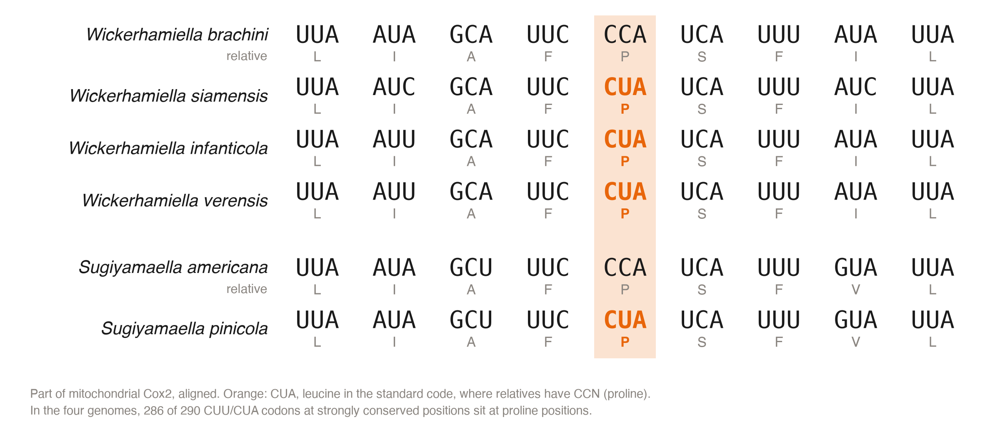

# Yeasts that read CUU and CUA as proline

A gene is read three bases (one codon) at a time, and each codon names one amino acid or a stop. Proline is spelled
CCN (CCU, CCC, CCA or CCG) in every known genetic code. CUU and CUA normally mean leucine.

In the mitochondria of four yeasts of the family Trichomonascaceae, ***Wickerhamiella siamensis***, ***W. infanticola***,
***W. verensis*** and ***Sugiyamaella pinicola***, CUU and CUA sit where related proteins have proline: **286 of 290
times** at strongly conserved positions. Leucine is spelled UUA/UUG, as in their relatives. The relatives put CCN at
these positions. The four sit on two separate branches of the yeast tree, so the change most likely happened twice.
As far as we can find, no genetic code was known to read any codon other than CCN as proline.

*Part of the mitochondrial protein Cox2, aligned. Amino acids below each codon are read with the mold mitochondrial
code (NCBI table 4), except CUA, shown as proline in the four.*

---

- **AI-generated.** The census, the analysis and the write-up were done by Claude (Anthropic) agents, run and curated
  by Ryan Xu.
- **Checked by AI, not yet by a human expert.** Separate agents audited the code and reproduced the signal without
  profile models, re-checked the four genomes blind to proline (with four controls), fact-checked every number and
  sentence before posting, and searched for prior work.
- **DNA only, so RNA editing is not ruled out.** No RNA or protein from these four yeasts is in public databases yet
  (we searched SRA, ENA, PRIDE and ProteomeXchange). RNA editing that turned U into C at every one of these codons
  would look the same in the DNA. In the one relative with enough public mitochondrial RNA, *W. versatilis* (which
  spells proline CCN), we found no U-to-C editing at the 4,456 coding positions read 20 or more times: the five U-to-C
  differences against another strain's DNA are all in this strain's own DNA, so they are strain differences. That
  test is preliminary, and it does not test the four yeasts.
- Corrections and criticism are very welcome: ryan@ryanxu.net.

### What was found

Codons at strictly conserved positions (at least 90% of about 22,700 mitochondrial genomes, weighted by family, have
one amino acid there):

| genome | at proline positions: CUU/CUA | CCN | other | at leucine positions: CUN | UUA/UUG |
|---|---|---|---|---|---|
| *W. infanticola* BK074532 | 78 | 2 | 11 | 0 | 140 |
| *W. siamensis* BK074538 | 82 | 0 | 9 | 0 | 149 |
| *W. verensis* BK074542 | 82 | 1 | 10 | 0 | 147 |
| *S. pinicola* BK074262 | 44 | 36 | 11 | 0 | 166 |
| the other 17 *Wickerhamiella* | 0–1 | 80–85 | | | |

Of the four genomes' 290 CUU/CUA codons at strictly conserved positions, 286 are at proline positions (the others: 3
phenylalanine, 1 alanine). CUC and CUG are used 0–1 times per genome in the protein genes, so their meaning can't be called.
Recount: [`src/check_numbers.py`](src/check_numbers.py).

### Evidence

- **Relatives.** The other 17 *Wickerhamiella* use CCN at 80–85 such proline positions and CUN at 0–1. Per genome,
  CUA sits at proline positions far more often than the other leucine codons do (one-sided Fisher test, p 1.9e-46 to
  2.1e-28 in the four). Among the 147 other mitochondrial genomes of the same class (Dipodascomycetes), none comes
  close (lowest p 0.019). CUU gives the same split.
- **Not a sequencing error.** Reads from each assembly's source run carry the codon at all 286 sites (3,782 to 46,781
  reads per genome, 98.9–99.6% agreeing). Reads from another lab's *W. siamensis* culture (PYCC 7069, 2024) carry
  CUU/CUA at all 82 sites (1,432 of 1,450 reads). PacBio reads of a second strain close to *W. infanticola* (DS02)
  have CUU or CUA as the commonest triplet at all 65 sites with 3 or more reads.
- **Blinded re-check.** A separate agent got the four genomes and four controls, and was not told that proline was in
  question. With Codetta and with alignments to 11 relatives, it called CUU and CUA as proline in exactly these four
  and found nothing else off table 4 in any of the eight.
- **Two origins.** In a tree of 49 mitochondrial genomes (concatenated proteins, CUN masked), the three
  *Wickerhamiella* form one branch (support 100%). *S. pinicola* sits deep inside *Sugiyamaella*, whose other 15
  species here use CCN (support 96–100% at each of the five nodes between them).

### What was known

- **CUN in yeast mitochondria had changed meaning twice already:** all four CUN codons to threonine in baker's yeast
  and many relatives (NCBI table 3), and CUU and CUA to alanine in *Ashbya gossypii*
  (Ling et al. 2014, *Nucleic Acids Res.* 42:499). *Ashbya* also avoids CUC and CUG, as the four do.
- **Proline is CCN in all 27 NCBI genetic codes.** The closest cases are mistranslation, not a code: some
  *Streptomyces* bacteria carry extra proline tRNAs that sometimes put proline at alanine, asparagine or threonine
  codons (Vargas-Rodriguez et al. 2021, *PNAS*; Schuntermann et al. 2023, *J. Biol. Chem.*).
- **The genomes were public, under the usual code.** All four assemblies come from Sarhan et al. (*Sci. Data* 13:28,
  December 2025), deposited without gene annotation. NCBI Taxonomy assigns these species the mold mitochondrial code
  (table 4, CUN = leucine), and Sarhan et al. used each taxon's code. Wolters et al. (2023, *Front. Microbiol.*)
  assembled *W. infanticola* first and assigned table 4; they ran Codetta, a code-prediction tool, only to choose
  between tables 3 and 4.

### Open points

- **Whether the proteins carry proline** (see the RNA-editing point above). The only other genomes in the census with
  CUU/CUA at proline positions are hornwort mitochondria, which are known to edit U to C; but hornworts keep CCN and
  use CUN for leucine too, while the three *Wickerhamiella* have almost no CCN left. We know of no U-to-C editing in
  fungal mitochondria.
- **How.** All four keep a tRNA-Pro (anticodon UGG), a tRNA-Leu (UAA) and a tRNA with anticodon UAG, the one that
  would pair with CUN. A preliminary follow-up (in `notes.md`) finds that in the three *Wickerhamiella* this UAG
  tRNA is the relatives' own UAG tRNA, which gained a C1:G72 pair otherwise typical of tRNA-Pro; *S. pinicola*'s has
  no such change. Which enzyme puts proline on it is open.
- **The second origin is the thinner one.** *S. pinicola* rests on one sequencing run of one strain, and it mixes CCN
  and CUU/CUA at proline positions within the same genes, which would also fit an intermediate stage or site-by-site
  editing.

### What would settle it

A mitochondrial proteome or RNA-seq of *W. siamensis* CBS 13331 or *W. infanticola* NRRL Y-17858; both are in public
culture collections. Peptides with proline at these positions would settle it.

### Files

- `notes.md`: the agents' full write-up (method, evidence, checks, the RNA-editing test, references)
- `figures/`: the figure above and the census grid with the tree (`pro_grid_tree.png`, in `notes.md`)
- `data/`: per-site and per-genome census tables, the Fisher tests, read tallies, the tree, the check reports, and
  the follow-up tRNA and RNA-editing tables; see [`data/README.md`](data/README.md)
- `src/`: the code; see [`src/README.md`](src/README.md). `uv run python -I src/check_numbers.py` recounts the numbers
  above from `data/`, and `uv run python -I src/fig_proline_rows.py out.png` draws the figure. The census itself needs
  files not included here (about 215 MB).
