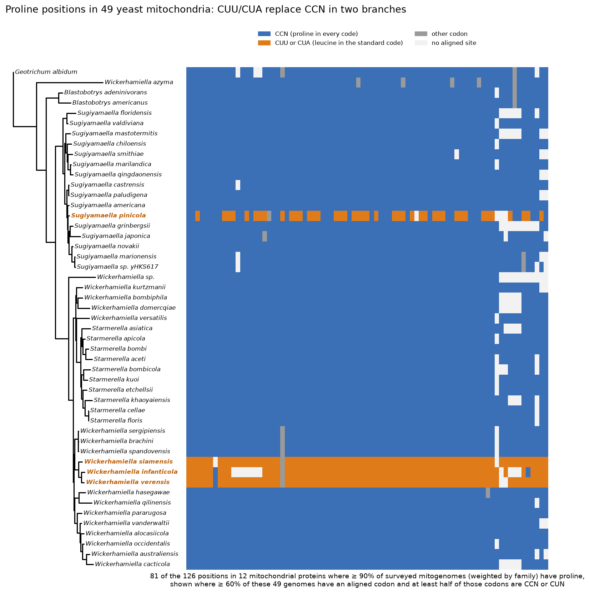

# Notes: yeasts that read CUU and CUA as proline

The agents' full write-up (method, evidence, checks, open points). The short version is in [`README.md`](README.md).
Times are US Eastern, November 2026. File paths are in this folder.

**Summary.** In the mitochondria of four yeasts, the codons CUU and CUA mean proline, not leucine. No known genetic
code reads any codon other than CCN (CCU, CCC, CCA, CCG) as proline. **All evidence is DNA. No RNA or protein from
the four yeasts is in public databases yet, so U-to-C RNA editing at these codons is not ruled out.**

## Background

Genes are read three letters (one codon) at a time. In the standard genetic code, 61 codons each name one of 20 amino
acids and 3 are stops. Some lineages, many of them mitochondria, read a few codons differently; NCBI lists 26
alternatives to the standard code. In yeast mitochondria, the four CUN codons (CUU, CUC, CUA, CUG; leucine in the
standard code) have already changed meaning twice: to threonine in baker's yeast and many relatives, and, in one of
those relatives, *Ashbya gossypii*, CUU and CUA to alanine.

## Finding

In four species of the yeast family Trichomonascaceae (*Wickerhamiella infanticola*, *W. siamensis*, *W. verensis* and
*Sugiyamaella pinicola*), CUU and CUA sit where related proteins have proline: of the four genomes' CUU/CUA codons at
strongly conserved positions, 286 of 290 are at proline positions (the other 4: 3 phenylalanine, 1 alanine). Leucine
is spelled UUA/UUG, as in their relatives, which barely use CUN at all. The four sit on two separate branches of the
yeast tree.

- **Per genome:** 44 to 82 CUU/CUA codons among their 91–93 positions where at least 90% of mitochondrial genomes
  (weighted by family) have proline; none at positions where they have leucine, which is spelled UUA/UUG 140 to 166
  times. *S. pinicola* still uses both: at its 91 such positions, 44 CUU/CUA, 36 CCN and 11 other codons.
  (`data/census/cun_sites.tsv`, `strict_pro_codons.tsv`, `pro_leu_wss.tsv`)
- **In relatives:** the other 17 *Wickerhamiella* use CCN at 80–85 such proline positions and CUN at 0–1. Per genome,
  CUA sits at proline positions far more often than the other leucine codons do (one-sided Fisher test, p 1.9e-46 to
  2.1e-28 in the four); among 147 other mitochondrial genomes of the same class (Dipodascomycetes), none comes close
  (lowest p 0.019, from a single CUA at a proline position). CUU gives the same split (the four: p 2.5e-6 to 1.8e-8;
  the 147 others: lowest 0.049). (`data/census/cun_CTA.tsv`, `cun_CTT.tsv`)
- **Raw reads** carry the codon at every one of 286 sites in the four genomes (3,782 to 46,781 reads per genome,
  98.9–99.6% agreeing; `data/reads/census_set_reads.out`). These reads are from the runs each assembly was built from,
  so this shows the assemblies are faithful to their reads; the two sequencings below are the independent ones.
- **Two more sequencings:** reads from another lab's *W. siamensis* culture (PYCC 7069, Portuguese Yeast Culture
  Collection, 2024) carry CUU/CUA at all 82 sites (1,432 of 1,450 reads; `data/reads/iso_census.out`). PacBio reads
  of a second strain, DS02 (2017; filed as *W. infanticola* with its reads and as *W. sorbophila* with its 2017
  genome assembly; its mitochondrial contigs match the *W. infanticola* mitochondrial genome at about 97% identity,
  against 92% between *W. infanticola* and its closest other species), carry CUU or CUA as the commonest triplet at
  all 65 sites with 3 or more reads. That assembly's mitochondrial contigs, which a later scan of whole-genome
  assemblies reached on its own, put CUU or CUA 78 times at conserved proline positions and never at conserved
  leucine. (`data/reads/other_sequencings/`, `data/checks/ds02_identity/`)

*81 of the 126 strictly conserved proline positions in 12 mitochondrial proteins, in 49 genomes of the order, with
the tree (`src/codes_census/pro_grid.py`; the numbers are in `data/census/pro_grid_tree.tsv`).*

## Method and checks

- **Census.** About 22,700 mitochondrial genomes (18,015 of the 18,031 in RefSeq, plus one per additional species
  from the rest of GenBank) were translated with their declared codes, every protein aligned to profile models, and
  each codon placed at its profile column (`src/codes_census/census_org.py`). A column is strict if at least 90% of
  genomes, weighted by 1/(genomes in their family), have one amino acid there (`sitescan_org.py`). The census was
  built to look for new stop codons; this came out of it. The census files (about 215 MB) and the profile models are
  not included; `src/cun_pro/export_sites.py` wrote the small tables in `data/census/` from them.
- **Codon contrast** (`src/codes_census/codon_contrast.py`). CUA (or CUU) at strict proline versus strict leucine
  columns, against its leucine synonyms, per genome, one-sided Fisher test, over all 151 Dipodascomycetes.
- **Raw reads** (`src/codes_census/reads_codons.py`). Reads from each assembly's source run were mapped with minimap2
  to the genome's ORFs and the codon in each read tallied at every site. The ORF set overlaps itself, so reads in
  shared regions get mapping quality 0; at mapping quality 20 or more, only 2–40 sites per genome are covered, at
  98.6–99.6% agreement (`data/reads/mapq20/`).
- **Audit** (fresh agent; `data/checks/audit_report.md`). No code bug creates the signal. Its own method without
  profile models (pairwise alignment to relatives' proteins) reproduces it in all four and not in a same-genus
  control. It found that the read check had used a slightly different site set; the read numbers here are recounted
  on the census set.
- **Blinded re-check** (separate agent, own code; `data/checks/blind_recheck/report.md`, `src/blind_recheck/`). It
  got the four genomes and four controls (*W. azyma* BK074526, *W.* sp. BK074539, *S. castrensis* BK074252,
  *Starmerella aceti* BK074222). It was told that table 4 was the default and table 3 (yeast mitochondrial) the
  alternative, which points at the CUN codons, but not that proline was in question; organism names were visible.
  With two methods (Codetta, and ortholog alignments to 11 relatives), it called CUU and CUA as proline in exactly
  these four and nothing else off table 4 in any of the eight. At conserved positions in relatives' orthologs, CUU
  stood at proline in 75 of 76 cases and CUA in 298 of 300.
- **Tree** (`data/tree/`, `src/tree/`). 49 mitochondrial genomes, concatenated proteins, 4,403 aligned positions, CUN
  masked so the code can't drive it; IQ-TREE, LG+F+G4, 1,000 ultrafast bootstraps. The three *Wickerhamiella* form
  one branch (support 100%). *S. pinicola* sits deep inside *Sugiyamaella*, whose other 15 species here use CCN; the
  five nodes joining it to them have support 96, 96, 100, 99 and 100 (`data/tree/support_wt_ufboot.txt`). So the
  change most likely arose twice.
- **Fact-checks** (fresh agents): `data/checks/factcheck.md`, `prepost_check.md` (re-derived every number with its
  own loader; the signal holds at 95% and 99% thresholds and with the four, or all Dipodascomycetes, left out of the
  consensus), `postcheck_additions.md`, and `tweet_check.md` for the thread.

## Known before

- **CUN in yeast mitochondria.** All four CUN codons mean threonine in *Saccharomyces* and many relatives (NCBI table
  3). In *Ashbya gossypii* CUU and CUA mean alanine, read by a tRNA that most likely arose by duplication of the
  threonine tRNA (itself descended from tRNA-His) and charged by the alanine enzyme, and CUC/CUG are avoided (Ling et
  al. 2014). The four genomes here also avoid CUC and CUG.
- **Proline.** Proline is CCN in all 27 NCBI codes (tables 1–33, with gaps), and no genetic code in any organism or
  organelle is known to read another codon as proline. The closest cases are partial mistranslation: some
  *Streptomyces* bacteria carry extra proline tRNAs that sometimes put proline at alanine, asparagine or threonine
  codons (Vargas-Rodriguez et al. 2021; Schuntermann et al. 2023).
- **These genomes.** All four assemblies come from Sarhan et al. 2025 (GenBank BK074262, BK074532, BK074538,
  BK074542), deposited without gene annotation; NCBI Taxonomy assigns these species the mold mitochondrial code
  (table 4, CUN = leucine), and Sarhan et al. annotated each genome with its taxon's code. Wolters et al. 2023 (353
  yeast mitochondrial genomes) assembled *W. infanticola* first (GenBank OR703884, identical to BK074532 and from the
  same sequencing run; `data/checks/OR703884_vs_BK074532.paf`) and assigned it table 4. They ran Codetta, a
  code-prediction tool, but used it only to choose between table 4 and baker's yeast's table 3, so a proline call
  would not have changed their choice.
- The novelty claim rests on searches. A Codetta run on these genomes would have flagged it (the blinded re-check's
  Codetta did), so someone may have seen it and not published.

## Not known

- **Whether the proteins carry proline.** Everything here is DNA. RNA editing that turned U into C at every one of
  these codons would look the same; we know of no such editing in fungal mitochondria. The only other genomes in the
  census with CUU/CUA at proline positions are hornwort mitochondria, which are known to edit U to C; but hornworts
  keep CCN and use CUN for leucine too, while the three *Wickerhamiella* have almost no CCN left. See the RNA test
  below.
- **How.** All four keep tRNA-Pro (anticodon UGG), tRNA-Leu (UAA) and a tRNA with anticodon UAG, the one that would
  pair with CUN. That UAG tRNA is no more like tRNA-Pro than like other tRNAs, and related yeasts that read CUN as
  leucine have a similar one. Which tRNA and which enzyme put proline at CUU/CUA is open.
- **The second origin is the thinner one.** *S. pinicola* rests on one sequencing run of one strain (NRRL YB-2263),
  and it mixes CCN and CUU/CUA at proline positions within the same genes, which would also fit an intermediate stage
  or site-by-site editing.
- **CUC and CUG** are used 0–1 times per genome in the protein genes, so their meaning can't be called.

The next step is a mitochondrial proteome or RNA-seq of *W. siamensis* CBS 13331 or *W. infanticola* NRRL Y-17858;
both are in public culture collections. Peptides with proline at these positions would settle it.

## Follow-up (20 Nov): the tRNA and a first RNA-editing test

A second agent ran two arms under rules written before any target analysis (`data/followup/RULES.md`; results in
`data/followup/RESULT.md`, whose overall verdict was left open). Both are preliminary.

**RNA editing (arm R).** No RNA or proteome was found for any of the four species or their strains (SRA, ENA
including strain searches, PRIDE, ProteomeXchange; NCBI STAT and Logan were not searched;
`data/followup/rna_editing/R0_summary.md`). Five RNA runs of relatives were tried. Only one had enough mitochondrial
reads to test: SRR30194995, *W. versatilis* PYCC 7102 (3.8% mitochondrial reads), a relative that spells proline CCN
(84 CCN and 0 CUN at strict proline columns). At the 4,456 coding positions read 20 or more times (about a quarter of
its coding bases), it has 42 RNA-DNA differences against the DNA of another strain, every one fixed in all reads
(alt fraction at least 0.8), so most likely strain differences; 5 are U-to-C. Against Nanopore DNA of the same strain
(SRR38099989), 40 of the 42, including all 5 U-to-C, disappear (`rdd_with_ont_filter.txt`, `ont_check.txt`). So no
U-to-C editing was found in this relative. A positive control on *Arabidopsis* mitochondrial RNA found the known C-to-U
edits (452 coding edits, all C-to-U). An audit's relaxed-mapping step never finished. This tests editing in the
family, not in the four.

**The tRNA (arm T).** In the three *Wickerhamiella*, the UAG tRNA is the ortholog of their CCN-using sisters' UAG tRNA,
at the same place in the genome, not a duplicated tRNA-Pro. On the branch to the three it gained a C1:G72 acceptor
pair, which is in the tRNA-Pro of 48 of 49 genomes of the order and in none of 1,083 tRNAs of other classes. The only
other UAG tRNA with it is in *W. versatilis*, which hardly uses CUN, so it is not evidence of proline charging on its
own. *S. pinicola*'s UAG tRNA shows no such change, so the two origins did not converge on the same tRNA change. An
audit by a fresh agent confirmed the numbers and found the three *Wickerhamiella* sequences are one event, not three
(`data/followup/trna/audit_REPORT.md`).

## References

- Ling J. et al. 2014. Natural reassignment of CUU and CUA sense codons to alanine in *Ashbya* mitochondria.
  *Nucleic Acids Res.* 42:499.
- Sarhan et al. 2025. *Sci. Data* 13:28 (December 2025). The four assemblies.
- Wolters et al. 2023. *Front. Microbiol.* 353 yeast mitochondrial genomes.
- Vargas-Rodriguez et al. 2021. *PNAS*. Extra proline tRNAs in *Streptomyces*.
- Schuntermann et al. 2023. *J. Biol. Chem.*
- Shulgina Y. & Eddy S. R. 2021. Codetta. *eLife* 10:e71402.
- NCBI genetic codes, tables 1–33.
