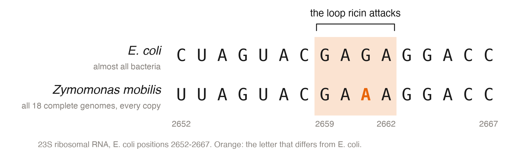

# Bacteria that changed the ribosome's ricin-target loop

The ribosome's large RNA (23S rRNA in bacteria) has a short hairpin near its end, the sarcin-ricin loop (SRL). The
translation factors EF-Tu and EF-G bind it, and two toxins are named after what they do to it: ricin removes the
adenine A2660, and α-sarcin cuts the RNA after G2661. Its four-base tip reads GAGA (2659–2662 in *E. coli*
numbering) and is described as universally conserved.

We read the 23S of 15,739 bacterial genomes from GTDB release 232 (about 8% of GTDB's bacterial species). **85 genomes
from 13 phyla read GAAA in every full-length copy**, among them the ethanol bacterium ***Zymomonas mobilis***: all 18
of its complete-genome assemblies (11 strains, including the model strain ZM4) read GAAA in every copy. A second
variant, **GCAA** (A2660C plus G2661A, so ricin's adenine is changed too), is in 17 census genomes and in every copy
of all 53 complete assemblies of the cheese bacterium ***Propionibacterium freudenreichii***. Their closest relatives
read GAGA. Both loops have sat, without comment, in public rRNA alignments since 2001; we found no paper that names
either.

*The loop and its stem in* E. coli *and* Z. mobilis*, read from the genomes. Orange: the loop base that differs.*

---

- **AI-generated.** The census, the analysis and the write-up were done by Claude (Anthropic) agents, run and curated
  by Ryan Xu.
- **Checked by AI, not yet by a human expert.** Fresh agents re-read every census copy with their own code, recounted
  all complete *Z. mobilis* and *P. freudenreichii* assemblies (with planted-variant and *E. coli* controls),
  audited the read check twice, fact-checked every sentence and searched for prior work twice.
- **Computational only.** Nobody has tested these ribosomes.
- Corrections and criticism are very welcome: ryan@ryanxu.net.

### What was found

| | Loop | Genomes | Copies |
|---|---|---|---|
| *E. coli* and almost all bacteria | GAGA | SILVA 138.2: 177,309 of 177,481 bacterial entries (99.9%) | |
| *Zymomonas mobilis* | GAAA | all 18 complete assemblies (11 strains) | every copy |
| GTDB census, 13 phyla (incl. *Z. mobilis*) | GAAA | 85 of 15,739 | every full-length copy |
| GTDB census, 6 phyla | GCAA | 17 | every full-length copy |
| *Propionibacterium freudenreichii* | GCAA | all 53 complete assemblies (about 48 strains) | 120 of 120 |

### Evidence

- ***Zymomonas*.** Two complete genomes in the census, then two more assemblies found by a check agent, then both ZM4
  assemblies, then every complete *Z. mobilis* genome in GenBank recounted by another agent with separate code: 18
  assemblies, 2 or 3 copies each, all GAAA, none GAGA. In ZM4 the hits fall inside the three annotated 23S genes. None
  of 105 other Sphingomonadaceae in the census differs at 2661.
- ***P. freudenreichii*.** 120 of 120 copies GCAA in 53 assemblies from 12 submitters and several sequencing
  platforms, including the type strain DSM 20271. Short reads of two strains agree (60 of 61 and 247 of 261 reads
  GCAA, none GAGA). Four sister species read GAGA (9 copies, partly draft assemblies).
- **Metagenome-assembled carriers.** 80 of the 85 GAAA genomes come from metagenomes. For 3 of them, reads from the
  source metagenome carry GAAA (16, 39 and 61 read pairs) and none from the genome's own population carries GAGA. The
  other 77 rest on the assemblies.
- **No partner change found.** Conserved residues of IF2, EF4 and BipA, which also dock on the loop, did not change
  with GAAA across its origins (best p = 0.11; power not measured). EF-Tu and EF-G were not tested.

### What was known

- The loop is described as universally conserved (Marchant & Hartley 1994; Aval et al. 2025).
- **Both changes were made in *E. coli*.** G2661A rRNA is assembled into ribosomes alongside wild-type 23S, and naked
  G2661A 23S is not depurinated by ricin A-chain (Marchant & Hartley 1994, 1995). A GCAA loop supports growth as the
  only 23S, with mild cold sensitivity and weaker RelA activation by empty ribosomes
  ([Kudrin et al. 2018](https://pmc.ncbi.nlm.nih.gov/articles/PMC5829649/), *Nucleic Acids Res.*).
- **GAAA is the normal SRL of animal mitochondria** (Mears et al. 2002; human mitochondrial DNA).
- **The sequences were in the databases.** The Gutell lab's CRW bacterial 23S alignment of 2001 holds *Z. mobilis*
  (GAAA) and *P. freudenreichii* (GCAA) as its only two non-GAGA loops among 226 entries, and SILVA 138.2 holds 42
  *Zymomonas* GAAA and 83 *P. freudenreichii* GCAA entries, all without comment.
  [Blanchet et al. 2014](https://pmc.ncbi.nlm.nih.gov/articles/PMC4176186/) (*Nucleic Acids Res.*, Table 1) count one
  unnamed natural GCAA sequence; it is identical to *P. freudenreichii* (our identification; the paper names no
  organism). In SILVA that 17-nt sequence occurs only in *P. freudenreichii* entries.
- We found no paper that names either organism's loop or tests its ribosomes against ricin or α-sarcin. So what is
  new is naming the carriers and showing the changes are fixed across each species and recur across bacteria.

### Open points

- **What GAAA does to translation.** *Z. mobilis* ZM4 is easy to grow and has genetic tools; factor binding, GTPase
  activation, a structure and α-sarcin or ricin sensitivity could all be tested.
- **EF-Tu and EF-G** were not tested for matching changes.
- **Metagenome-assembled carriers:** reads checked for 3 of 80; reads cannot test binning, and one carrier is probably
  mis-binned.
- **Coverage:** the census holds about 8% of GTDB's bacterial species.
- **Prior art not opened:** Lee et al. 2001 (*Mol. Cells*, a *Z. mobilis* 23S structure; paywalled) and a 2026
  preprint on symbiont rRNA changes.

### Files

- `notes.md`: the agents' full write-up (evidence, prior work, method, checks, references)
- `figures/`: the figure above (`src/fig_srl_rows.py`) and the census figure in `notes.md` (`src/fig_srl.py`)
- `data/`: census, read-check, SILVA and *P. freudenreichii* tables and the check reports; see
  [`data/README.md`](data/README.md)
- `src/`: the analysis; see [`src/README.md`](src/README.md). The two figure scripts run on what is here
  (`uv run python -I src/fig_srl_rows.py out.png`); the census scripts need the lab's working tree, not included
