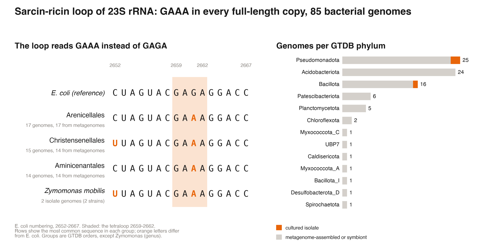

# Notes: bacteria that changed the ribosome's ricin-target loop

The agents' full write-up (method, evidence, checks, open points). The short version is in [`README.md`](README.md).
Times are US Eastern, November 2026. File paths are in this folder.

**Summary.** The sarcin-ricin loop of the ribosome, described as universally conserved, reads GAAA instead of GAGA in
every full-length 23S rRNA copy of 85 bacterial genomes from 13 phyla. They include the ethanol bacterium *Zymomonas
mobilis*: all 18 of its complete-genome assemblies (11 strains, including the model strain ZM4) read GAAA in every
copy. A second variant, GCAA, is in 17 census genomes and fixed across the cheese bacterium *Propionibacterium
freudenreichii*. **All evidence is computational. Nobody has tested these ribosomes.**

## Background

The sarcin-ricin loop (SRL) is a short stem-loop near the end of the large ribosomal RNA (23S in bacteria). The
translation factors EF-Tu and EF-G bind it. Its tip is a four-base loop, G2659 A2660 G2661 A2662 in *E. coli*
numbering. The loop is named after two toxins that act on it: ricin removes the adenine base of A2660, and α-sarcin
cuts the RNA between G2661 and A2662. Papers describe the loop as universally conserved.

## Finding

We read the 23S of 15,739 bacterial genomes from GTDB release 232: the lab's cached genomes, about 8% of GTDB's
189,801 bacterial species, almost all one genome per species. Then we listed every genome whose 23S differs at a
named functional site.

- **85 genomes read GAAA in every full-length 23S copy.** That is G2661A, the G that α-sarcin cuts after. They span 24
  GTDB orders in 13 GTDB phyla (11 if split phyla such as Bacillota and Bacillota_I are merged) and 59 BioProjects.
  Most sit in three orders: Arenicellales (17), Christensenellales (15) and Aminicenantales (14). Whole clades carry
  it; for example, 22 of the 24 Aminicenantia genomes in the census do.
- **Most are assembled from metagenomes (80 of 85), but not all.**
  - *Zymomonas mobilis* reads GAAA in two complete genomes in the census: ATCC 10988 (2 of 2 copies) and ATCC 29192
    (3 of 3).
  - A fresh check agent found it in two more assemblies, NBRC 13757 (1 of 1) and DSMZ 22645 (3 of 3). Both are
    deposits of the ATCC 29192 strain.
  - Both assemblies of the model strain ZM4 (2010 and 2018) carry it, in three copies each, with no copy carrying GAGA.
  - A second agent then checked every complete *Z. mobilis* genome in GenBank with separate code: 18 assemblies from
    11 strains, 2 or 3 copies each, all GAAA, none GAGA (`data/zymomonas/`). In ZM4 the three hits fall inside the
    three annotated 23S genes. So the loop is species-wide, and assembly error cannot explain it here.
  - None of the 105 other Sphingomonadaceae genomes in the census (*Sphingomonas*, *Novosphingobium* and relatives)
    differs at 2661. So the change arose in the *Zymomonas* line.
  - One more cultured bacterium carries it: *Anaerocaecibacter muris* (a type-strain assembly). The remaining four
    are uncultured. Three are symbionts sequenced together with their hosts, and one of those three (*Ca.*
    Nesciobacter) is itself assembled from a metagenome.
- **A second variant, GCAA (A2660C plus G2661A), is in every full-length copy of 17 genomes from 6 phyla.** Here
  A2660, the adenine that ricin removes, is changed too. Three more genomes read GCGA (A2660C alone).
  - Outside the census, *Propionibacterium freudenreichii* reads GCAA in all 120 23S copies of its 53 complete-genome
    assemblies in NCBI (about 48 strains, 12 submitters, including the type strain DSM 20271), with no copy reading
    anything else.
  - Short reads of two strains agree (60 of 61 and 247 of 261 reads GCAA, none GAGA).
  - Its four sister species read GAGA (9 readable copies, including three type strains; several are drafts), so the
    change arose in the *P. freudenreichii* line.
  - A fresh agent confirmed all of this with its own code (BLAST against the *E. coli* 23S, planted-variant controls;
    `data/checks/pfreudenreichii_independent.md`).
- **One carrier is probably mis-binned.** The 23S of GB_GCA_045641205.1, a Planctomycetota genome assembled from a
  metagenome, is 92% identical to a Christensenellales carrier from the same BioProject and at most 82–87% to any
  Planctomycetota 23S. Its GAAA probably belongs to a Bacillota relative. Planctomycetota keeps 4 other carriers. Two
  of them share that BioProject and their 23S is about as close to Bacillota as to Planctomycetota. The other two come
  from other BioProjects and have clearly Planctomycetota 23S, so the phylum count stays at 13. The binning check
  flags 5 of 85 carriers whose 23S best matches another phylum (against 12 of 400 random genomes). Only this one has a
  close relative elsewhere; the other four have no relative above 89% in the census. When other carriers are left out
  as reference, carriers place with their GTDB class and order less often than random genomes (order 0.60 against
  0.89), partly because carriers come in whole clades.
- **The calls were attacked before posting.** A fresh agent re-read every copy from the genomes, using its own code
  (`data/census/recount.*`).
  - It found that 10 of the 116 genomes the pipeline had listed as G2661A had a long insert inside the loop, which the
    alignment had misread. Those 10 are dropped.
  - 102 genomes keep G2661A in every full-length copy, and 85 of them carry the full GAAA loop.
  - Two of the 85 also have partial 23S pieces that read GAGA.
- **Reads agree with the assembly in the 3 metagenome-assembled carriers checked** (`data/reads/summary.tsv`). For
  each, the Illumina reads of its source metagenome (both samples, for the one co-assembly) were mapped to the
  genome's own 23S, and independent read pairs at least 98% identical to that 23S outside the 12 loop bases, which
  should be the genome's own population, were counted.
  - All three carry GAAA: an Aminicenantales from salt-lake sediment (16 read pairs), a Christensenellales from mouse
    gut (39) and a UBA2199 from lake sediment (61, from both samples).
  - No read pair from that population carries GAGA. Three single reads differ from the assembled sequence at one
    position each, and all three look like sequencing errors. Only one of them changes the loop (GACA), and that one is
    contradicted by its own mate, which reads GAAA. The GAGA reads that do map differ by more than 2% elsewhere in the
    23S, so they come from relatives in the same sample.
  - This tests the assembled sequence, not the binning: it cannot show that the 23S belongs to the genome it was
    binned with.
  - These three were picked from carriers with short-read source data. The other 77 metagenome-assembled carriers are
    unchecked.
- **No partner change found.** If the loop changed, the factors that dock on it might change with it.
  - The conserved residues of the three SRL-binding GTPases in GTDB's marker set (IF2, EF4 and BipA) did not change
    with GAAA across its independent origins, by a test planned before it was run (best p = 0.11;
    `data/census/gaaa85.*`). 0 of 149 tested columns pass.
  - The test's power was not measured.
  - EF-Tu and EF-G are not in the marker set and were not tested.

*The census figure (`src/fig_srl.py`, numbers in `data/census/loops.tsv` and `phyla.tsv`). The row counts are census
genomes only; Z. mobilis has 18 complete assemblies in GenBank, all GAAA.*

## Known before

- The loop is described as universally conserved (Marchant & Hartley 1994; Aval et al. 2025). The broadest
  per-position survey we found used 915 bacteria and a roughly 90% threshold (Doris et al. 2015). It would not flag a
  change in under 1% of genomes.
- Both loops have been made in *E. coli*:
  - G2661A rRNA is assembled into ribosomes alongside wild-type 23S (Marchant & Hartley 1994).
  - Naked G2661A 23S rRNA is not depurinated by ricin A-chain (Marchant & Hartley 1995).
  - A GCAA loop supports growth as the only 23S rRNA in the cell. The cells grow normally at 32–42 °C and are mildly
    cold-sensitive. RelA is activated less by empty ribosomes, but normally by starved complexes (Kudrin et al. 2018).
  - So GCAA is known to work as a cell's only loop. GAAA has not been shown to in a bacterium.
- GAAA is the normal SRL loop of animal mitochondrial ribosomes. It is in the comparative tables of Mears et al. 2002
  (*C. elegans* mitochondrion) and in the human mitochondrial 16S rRNA (TGTAC**GAAA**GGAC at 3127–3130 of
  NC_012920). Another agent found it in 2,621 of the 2,624 animal mitochondrial genomes its probe reached (2 read GAGA
  and 1 AAAA, unchecked), all but 4 of them vertebrates. So the loop is already known to work in one kind of ribosome.
- The same loop, and GCAA, GGAA and GUAA, also occur in the apicoplasts of piroplasm parasites (*Babesia*,
  *Theileria*); that is a separate draft, not included here.
- **Both loops have sat, without comment, in public rRNA alignments for 25 years** (`data/checks/priorart_crw_silva.md`).
  - The Gutell lab's Comparative RNA Web Site (CRW) bacterial 23S alignment of 2001 contains *Z. mobilis* (AF086792)
    with GAAA and *P. freudenreichii* (Y10819) with GCAA. They are the only two non-GAGA loops among the 226 entries
    that cover it. CRW's three-domain conservation diagram (592 sequences, November 2001) draws each loop base as
    "98+% conserved".
  - SILVA (release 138.2, LSU Ref), read with an exact flanking match (`data/silva/`): 177,309 of 177,481 bacterial
    entries (99.9%) read GAGA. All 42 entries filed under *Zymomonas* read GAAA, and all 83 *P. freudenreichii*
    entries GCAA. The other GAAA entries are mostly *Aminicenans* (27), in line with the census. The *E. coli* control
    reads GAGA in 15,324 of 15,326 entries.
  - The sequences themselves have been public since 1997 (*P. freudenreichii*) and 1998 (*Z. mobilis*).
  - The one unnamed GCAA sequence in Blanchet et al. 2014 (Table 1; from a bacterial 23S alignment, along with two
    with a U–A closing pair) is UUAGUACGCAAGGACCG. That 17-mer is identical to *P. freudenreichii*; the paper does not
    name the organism, so the identification is ours. Another agent checked it independently: in SILVA 138.2 LSU Ref
    this 17-mer occurs only in *P. freudenreichii* entries (83), and the other GCAA entries (5 gut-metagenome entries)
    carry different flanks. GAAA alone is not in their table.
- **No paper names either loop.** Two prior-art searches (fresh agents, Europe PMC including preprints) found no
  report of a natural G2661 change in any bacterium or archaeon, and nothing on the SRL, or ricin or α-sarcin
  sensitivity, of *Zymomonas* or *P. freudenreichii*. Kudrin et al. 2018 give no natural source for their GCAA
  mutant. (The first search missed the animal mitochondrial GAAA above; a later search found it.)
  - Not opened: Lee et al. 2001 (*Mol. Cells*), which proposes a *Z. mobilis* 23S secondary structure and may show
    the loop (paywalled). RiboVision gives only per-position entropy, with no variant list.
  - A 2026 preprint on symbiont rRNA changes was not read in full.

## Found here

- GAAA, known before as the animal mitochondrial loop and as a lab mutant in *E. coli*, is the natural and only SRL
  loop in the full-length 23S copies of 85 bacterial genomes across 13 phyla. One of them is a well-studied cultured
  species, in which every sequenced strain carries it.
- GCAA, a lab mutant with a mild cold-sensitive phenotype, is natural in 17 census genomes and fixed across
  *P. freudenreichii*. That species' GCAA was very likely the one unnamed natural GCAA counted in a 2014 alignment
  (Blanchet et al.).
- Neither change is new to the databases: both organisms' loops sit in CRW (2001) and SILVA. What is new is naming
  them and showing they are fixed across each species.

## Not known

- What GAAA does to translation. *Z. mobilis* ZM4 is easy to grow and has genetic tools, so its ribosomes could be
  tested directly: factor binding and GTPase activation, a structure, and α-sarcin or ricin sensitivity.
- Whether EF-Tu and EF-G have adapted. They were not tested.
- Whether the metagenome-assembled carriers are correct. Reads were checked for 3 of 80 and agree with the assembly;
  the others rest on assemblies only, and reads cannot test binning.
- How common it is. The census covers about 8% of GTDB's bacterial species.
- *P. freudenreichii*: 48 strain names are not 48 independent lineages, and the sister-species evidence rests on 9
  copies from partly draft assemblies.

## Method

1. **Census.** The 23S rRNA of 15,739 bacterial genomes was found and aligned to *E. coli* numbering, and each
   full-length copy read at named functional sites. Candidate rules were written before the census was read
   (`src/lsu_candidates.py`).
2. **Re-read.** A fresh agent re-read every listed genome from the raw assembly with its own code
   (`data/census/recount.*`).
3. ***Zymomonas*.** Exact 13-nt context matches on both strands in both ZM4 assemblies (GCF_000007105.1,
   GCF_003054575.1), then all 18 complete *Z. mobilis* assemblies recounted by a second agent
   (`src/srl_zymo_recount.py`, `data/zymomonas/`).
4. **Reads.** For 3 metagenome-assembled carriers (`src/srl_readcheck.*`). Two audits by fresh agents found seven
   faults in earlier versions (identity counted the site's own bases, alignments dropped silently, mates double
   counted, no read-coverage rule, a file that included itself, a carrier left out of the summary, wrong read-pair
   counts), all fixed before the final counts. The audit reproduced every final count.
5. **Partners.** Marker residues tested for change with GAAA across independent origins (`src/srl_covar.py`, planned
   before it was run). It first ran on an earlier list of 87 (with 4 insert artefacts, missing 2 carriers); the rerun
   on the final 85 gives the same result.
6. **SILVA.** SILVA 138.2 LSU Ref read with an exact flank match (`src/srl_silva_a1.py`). The rule was frozen before
   reading; its amendment A1 (bacteria only) was added after the controls and the first table were read, before any
   per-genus listing. *E. coli* entries are the positive control.
7. ***P. freudenreichii*.** All 55 complete NCBI assemblies scanned by exact context (`src/srl_genomes.py`), with
   *E. coli* and *C. acnes* controls; then independently by BLAST against the *E. coli* 23S with planted-variant
   controls, short reads and sister species (`src/checks_pfreud/`).

## Checks

- Positive controls: *E. coli* K-12 7/7 GAGA, *C. acnes* 3/3 GAGA in both genome scans; planted GCAA and UUCG loops
  read back correctly.
- Sentence-by-sentence fact-checks of the write-up by fresh agents, recomputing every number and opening every
  citation. The first found ten errors or overstatements, all fixed before posting (among them: three strains, not
  five; 17 GCAA, not 20; "every copy" → "every full-length copy"). A second found three more (Blanchet 2014 counts one
  natural GCAA; the animal count is 2,621, not 2,623; the binning sentence hid the first metric), also fixed.

## References

- Aval et al. 2025.
- Blanchet S. et al. 2014. *Nucleic Acids Res.* 42:11261 (PMC4176186).
- Doris S. M. et al. 2015.
- Kudrin P. et al. 2018. *Nucleic Acids Res.* (PMC5829649; PMID 29390134).
- Lee et al. 2001. *Mol. Cells* (not opened).
- Marchant A. & Hartley M. R. 1994, 1995.
- Mears J. A. et al. 2002 (CRW comparative tables).
- CRW (Gutell lab) 23S bacterial alignment and conservation diagrams, 2001 (Wayback copies).
- SILVA release 138.2, LSU Ref.
