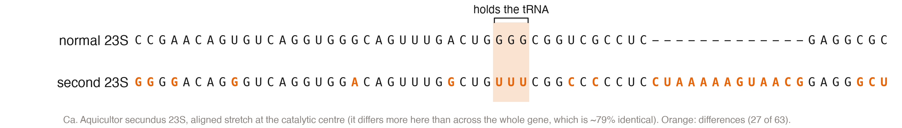
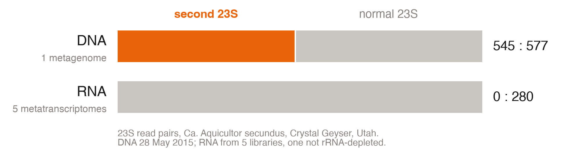

# Bacteria that keep a very divergent second rRNA operon whose rRNA barely accumulates

A ribosome is built around two RNAs: a large one (23S in bacteria) and a small one (16S). The catalytic core of the
23S, the peptidyl-transferase centre (PTC), joins amino acids into protein, and its bases are among the most conserved
in biology. The 16S reads the messenger RNA. Many bacteria carry several copies of the rRNA operon (16S, 23S, 5S),
and the copies in one genome are usually near-identical. The most divergent pair of bacterial 23S genes we found
reported differs by about 10%.

Most genomes of one family of uncultured groundwater bacteria, the **Aquicultoraceae** (15 of 18 genomes with a 23S,
six genera), carry a second rRNA operon that looks nothing like the first. Its 23S is about 79% identical to the
genome's normal 23S over aligned positions, and it changes PTC bases that are conserved in 99.7–99.98% of bacteria. Its
16S has lost the anti-Shine-Dalgarno sequence, which normally helps the ribosome find start codons, and, by alignment,
the decoding base A1492. The operon has been kept since before the family's genera split: it is inherited with the
lineage, and selection still keeps its folded shape.

Yet its rRNA barely accumulates. In the one species with RNA data, *Ca.* Aquicultor secundus from Crystal Geyser,
Utah, the second operon is in the DNA about one to one with the normal operon (545 : 577 23S read pairs). In RNA,
**0 of 280** 23S read pairs fall on its copy, across five libraries, one of them not rRNA-depleted, and its mature
16S is at most 7.5% of the normal 16S. A few precursor reads show that the operon is transcribed. As far as we can
find, no bacterial rRNA operon that is inherited and conserved but whose rRNA does not detectably accumulate has been
reported. The closest case is a single divergent 16S in *Borrelia afzelii* that "appears to be a pseudogene" (Pei et
al. 2010); it was not tested with RNA or shown to be conserved.

*The normal and the second 23S of* Ca. *Aquicultor secundus, an aligned stretch at the catalytic centre. The three G's
that hold the P-site tRNA (E. coli G2251–G2253) read UUU in the second copy. Orange: differences, 27 of 63 here, 13 of
them an insertion in the second copy; over the whole gene the copies are about 79% identical.*

*23S read pairs on the second (orange) and normal (grey) copy of* Ca. *Aquicultor secundus at Crystal Geyser: DNA,
one metagenome (28 May 2015), 545 : 577; RNA, five metatranscriptomes, one not rRNA-depleted, 0 : 280. Technical
version for the first three RNA samples, with the catalytic-centre bases:
[`figures/ptc_bases_and_reads.png`](figures/ptc_bases_and_reads.png).*

---

- **AI-generated.** The census, the analysis and the write-up were done by Claude (Anthropic) agents, run and curated
  by Ryan Xu.
- **Checked by AI, not yet by a human expert.** Separate agents, each with its own code, tried to break the result: a
  kill agent (own DNA, identity, PTC bases, structure; it also found the missing anti-Shine-Dalgarno sequence), an
  expression audit (it reproduced every count, simulated reads, and found the reads that show the operon is
  transcribed), a kill pass on the read tests of a second, unrelated species, and fact-checks of both write-ups that
  recounted the numbers and checked the citations (one, Ogle et al. 2001, was not on disk and could not be checked). The
  rules for the 16S tests were fixed before the data were read. Three further checks on 22 Nov (more RNA; processing and
  expression signals; origin and selection) wrote their rules before reading results (two amendments in the processing
  check came later and are marked), and fresh agents rechecked the main results with their own code. A prior-art check
  on 22 Nov searched for earlier reports. Several claims were corrected along the way; see [`notes.md`](notes.md).
- **Computational only.** Sequence alone cannot show what these RNAs do, and no functional test was possible. Nearly all
  the genomes were assembled from mixed-community DNA (metagenomes), and the RNA data come from one species at one site.
- Corrections and criticism are very welcome: ryan@ryanxu.net.

### What was found

| *Ca.* Aquicultor secundus, Crystal Geyser: read pairs | second copy | normal copy |
|---|---|---|
| DNA, 23S (metagenome, 28 May 2015) | 545 | 577 |
| RNA, 23S (5 metatranscriptomes: 0 : 129, 0 : 11, 0 : 23 from 25–27 May 2015; 0 : 74 CG05; 0 : 43 CG13, not rRNA-depleted) | 0 | 280 |
| RNA, mature 16S (SRR11558543, 25 May 2015) | 5 | 141 |
| RNA, 16S reads running on into the 16S–23S spacer (same run) | 4 | 13 |

Read pairs on the loci of this species' 8 genomes (23S: at least 98% identical), with the second and the normal copy in
one reference next to decoys from other species. At the DNA ratio, about 79 of the 163 RNA 23S read pairs in the first
three runs should fall on the second copy (P of seeing 0 = 8 × 10⁻⁴⁸), and about 57 of the 117 in the two further runs
(P = 1.6 × 10⁻³⁴). Per gene copy, the second 23S is at most about 2% as abundant as the normal 23S in the first three
runs, and at most 3.4% in the two further runs (95% bounds). Length-normalised, the second 16S is at most 7.5% of the
normal 16S (95% bound), and simulated unprocessed transcript gives about 18 body read pairs for 4 spacer pairs, so all 5
can be precursor.

| Across the family (GTDB release 232) | |
|---|---|
| Aquicultoraceae genomes with any 23S | 18 |
| … with a second, divergent 23S | 15, from six genera and about seven independent populations (8 are the Crystal Geyser species) |
| identity to the genome's normal 23S | about 79% over aligned positions (71–73% by local BLAST) |
| 16S lacking the anti-Shine-Dalgarno motifs CCUCC, GAUCACC and GUAACAAGG | all 6 second-copy 16S checked (5 genera); all 4 normal 16S checked have them |
| 16S lacking A1492 / A1493 (by alignment) | 6 of 6 / 5 of 6 |

### Evidence

- **It is the organism's own DNA, and it is old.** In the first genome found, DASXVE01 (GCA_036504445.1), reads cover
  the whole operon at the genome's depth with no break, and every read at ≥ 97% identity carries the changed PTC
  bases. The genes flanking the second operon recur next to the second operon in five other genera, and never next to
  normal operons, so it sits at its own place in the chromosome, inherited with the lineage. Five PTC changes
  (A2062C, G2251U, G2253U, U2504A, G2583A) are shared by the copies of three genera, so they predate the split of
  those genera.
- **Common in the family, not found outside it so far.** Against about 17,300 census 23S sequences (one per genome),
  the best hits outside the family reach about 80% over at most 0.66 kb, or about 74% over at most 1.3 kb. A scan of
  all 50,594 cached bacterial genomes for second 23S copies flagged 51 divergent copies. None of the flagged copies
  from outside the family is close to the family's second copy (at most 76% over 0.6 kb, or about 70% over 1.4 kb),
  and none of the 22 out-of-family genomes whose PTC could be read shows a change that survives a check.
- **The changed bases sit where the ribosome holds tRNA and makes peptide bonds.** In *E. coli*, G2251 and G2252 pair
  with the CCA end of the P-site tRNA, and lab mutations at G2251 are dominant lethal. In the Crystal Geyser copy,
  2251–2253 read UUU instead of GGG. The loop at 2449–2453, conserved as UAACA, is gone in all 6 second copies checked,
  from 5 genera (its exact bases depend on how the loop is aligned).
- **The 16S is rewritten too.** Besides the anti-Shine-Dalgarno sequence and A1492/A1493, the Crystal Geyser second 16S
  changes C1054, C1400, U1498, A790, G966 and C967, and the 1400-region motif CCGCCCGUC is absent. Of the 28 16S bases
  that touch the 23S in the *E. coli* ribosome (PDB 6OG7), 14 differ from the normal 16S (8.6 expected), while their
  24 assessable partners in the second 23S are unchanged.
- **The structure is kept, but less tightly than in a working rRNA.** In the second 23S, base pairs stay canonical
  83–86% of the time; a neutral-mutation null tops out at 74%, and 16 functional 23S genes at similar divergence score
  87–93%. Pair-breaking changes outnumber compensatory double changes 1.35–1.85 to 1, against a median of about 0.6 in
  the controls, and the second copies evolve about 2.2 times faster between genera. Between the same two genera, the
  second 16S copies evolve about 5 times faster than the normal ones.
- **Transcribed, but the 23S does not build up.** An independent audit remapped one RNA sample (27 May) with read mates
  split against the whole genome from the DNA sample. 7,063 read pairs fall on its protein genes, including genes on
  both sides of the second operon, and still no read touches the second 23S. 5 read pairs sit at the 3' end of the
  second 16S, 4 of them running on into the spacer before the 23S, all on the sense strand at 97–100% identity; in that
  sample the normal operon's reads stop at the 16S end. In simulated reads, the mapping recovered second-copy reads at
  least as well as normal ones.
- **No private message channel seen, within the test's power.** Bioengineers build "orthogonal ribosomes" whose 16S
  reads its own set of messages. In *Ca.* A. secundus, the second 16S tail (UUUCAAUUGGAUA) pairs with no more genes
  than matched decoys do, which rules out a tail-pairing channel covering ≥ 3% of genes (about 49 of 1,641).

### The checks of 22 Nov

Details, numbers and rechecks: [`data/silent_operon/`](data/silent_operon/).

- **More RNA: still 0, and not because of rRNA depletion.** Two more Crystal Geyser RNA libraries, counted the same
  way, give 0 : 74 (CG05, SRR11558439) and 0 : 43 (CG13, SRR6241672). The CG13 library is 92% rRNA, so it was not
  rRNA-depleted, and the zero holds there (0 : 39 if only mismatch-free pairs are counted, a borderline bound); a
  fresh agent recounted it with its own code and reference (0 : 44). With
  the three earlier runs, every informative Crystal Geyser RNA library gives 0 second-copy 23S read pairs: 0 : 280 in
  total. Depletion probes would not explain the zero anyway. Probe kits are built on *E. coli* and *B. subtilis* rRNA,
  and 21% / 30% of the normal *A. secundus* 16S lies in 50-nt windows ≥ 90% identical to them, against 0% / 0% of the
  second 16S (23S: 5% / 15% against 1% / 3%). Depletion would remove the normal copy more, not the second. The
  "viral communities" label of the 2015 runs looks like a project title; the paper that used them describes cell
  filters. No RNA data that contain the reads of any other carrier
  species were found.
- **Processing: the second 16S seems to lack its RNase III stem.** In the normal operon, the RNA on either side of the
  16S pairs into a long stem that RNase III cuts to release the 16S from the precursor. No such stem was found for the
  second 16S in any of the six genera (or in the sister-family copy below) by the recheck's scorer; the first scorer
  found none in 5 of 6 and a weak one in one CADDYS01 genome. The normal 16S has a stem in most genomes. This is
  descriptive, not calibrated: neither 16S stem test passed its positive control, *Thermobispora bispora*, whose working
  16S stems were not reliably called, and one scorer also finds the normal 16S stems weak. The second 23S keeps a short
  stem core (14–18 bp, about *E. coli*'s length), held by compensatory changes between genera, but weaker than the
  normal one. The second operon has lost its 5S gene in 3 of 5 assessable genera, *A. secundus* among them. Its promoter
  is consensus-weak in *A. secundus* and DASXVE01 (9 of 12 bases, against 11 of 12 for every normal operon; 11–12 of 12
  in the other genera, but not at a shared position), it has no leader boxA except in one CADDYS01 genome, and its
  upstream region is not conserved between genera (51% identity against 48% for shuffled pairs; normal operons 66%). It
  does keep a boxA in the 16S–23S spacer in 4 of 6 genera.
- **Origin: one ancient lineage, inherited, with no donor.** The second copies form one clade in both the 16S and the
  23S tree (UFBoot 100). A related 16S sits in JAMCWL01 (GCA_023481285.1), the sister family and the only other family
  of the order Aquicultorales in GTDB; it is sister to the clade (UFBoot 100) and shares 24 of the 41 changes the
  family's second copies share at ≥ 99%-conserved columns. So the lineage is older than the Aquicultoraceae genera.
  Inside the family, the gene trees of the second copies match the species tree (shared split: 98 and 100 in the gene
  trees, 99 in GTDB; no conflict with support ≥ 95). There is no donor: every outside sequence is about as far from the
  second 23S (0.721–0.731 identity over Rfam covariance-model columns) as the genome's own normal 23S is (0.708–0.717;
  the about 79% above is by pairwise alignment). There is no mobile element: none of the 243 genes within 10 kb of the
  second operon is a mobile, phage, defence, toxin-antitoxin, RNase, rRNA-modifier or ribosomal-protein gene (about 40
  of 578 near the normal operons are), and there is no GC island and no tRNA (one tRNA-Glu in one CADDYS01 genome).
  Where the lineage attaches deep in the tree is unresolved, and whether it was in the common ancestor of both families
  or moved between their early ancestors cannot be told apart.
- **Selection: the fold is kept, the working parts are not.** Over census base pairs, 93–95% stay canonical in the
  second 23S (normal 95%), against about 80% in a putative decaying rRNA copy of *Arsenophonus*, and the G-C share of
  paired positions rose in every population (loops gained G-C too). These pairing values come from a covariance-model
  alignment, which favours pairing; the model-free value above is 83–86%. Meanwhile, nucleotides that touch tRNA or mRNA
  change 3–6 times faster than expected from each copy's own rate at the same conservation (23S 5.4×, 16S 3.1×; about 20
  independent columns, permutation p ≤ 0.0005), and the excess fades with distance from the tRNA sites. The decaying
  *Arsenophonus* copy and a divergent operon of *Tenuifilum* do not show this.
- **Reading.** An RNA that is transcribed and kept folded, whose 16S is seen only as precursor and whose 23S does not
  accumulate, fits a structured RNA kept for something other than translation. It does not fit a second working
  ribosome or a decaying pseudogene. A decoy that binds ribosomal proteins, or a dead-end assembly intermediate, are
  hypotheses, not tested.

### What was known

- **No earlier report found.** A prior-art check on 22 Nov (about 25 web searches, Europe PMC, abstract level) found
  no bacterial or archaeal rRNA operon that is shared by descent, structurally constrained, and shown by RNA data to be
  nearly absent as mature rRNA. Every divergent operon tested for expression was reported as expressed, and usually as
  functional. In eukaryotes, by contrast, non-functional rDNA copies are well known.
- **Divergent rRNA operons in bacteria**, described as functional or expressed: *Thermomonospora chromogena*, 23S
  about 10% different (Yap, Zhang & Wang 1999, *J Bacteriol* 181:5201); *Scytonema hyalinum*, 16S 7.3–9.0% and 23S
  8.7% different (Johansen et al. 2017, *PLoS ONE* 12:e0186393); the archaeon *Haloarcula marismortui*, whose variant
  operon is expressed depending on temperature (López-López et al. 2007, *J Mol Evol* 65:687). A single *Borrelia
  afzelii* 16S copy diverges by 20% and "appears to be a pseudogene" (Pei et al. 2010, *Appl Environ Microbiol*
  76:3886).
- **A divergent operon that makes specialised ribosomes:** *Vibrio vulnificus* rrnI translates a subset of mRNAs
  through variable bases near the subunit interface, not through the anti-Shine-Dalgarno sequence (Song et al. 2019,
  *Nat Microbiol* 4:515). Unlike rrnI, the Aquicultoraceae second 16S has lost the canonical decoding bases.
- **The closest functional analogue is a eukaryote, in a preprint:** in *Plasmodium falciparum* a variant LSU rRNA
  "appears to elongate inefficiently, likely due to divergences in the peptidyl transferase center" and acts as a
  translational repressor (Vignolini … Baumgarten 2026, bioRxiv
  [10.64898/2026.06.17.732804](https://doi.org/10.64898/2026.06.17.732804)).
- **The changed bases.** G2252 pairs with C74 of P-site tRNA (Samaha, Green & Noller 1995) and G2251 with C75; the
  G2252–C74 pair is "not essential for peptide bond formation" but important for peptide release (Feinberg & Joseph
  2006); G2251 mutations are dominant lethal (Green, Samaha & Noller 1997). A2451 mutants keep significant
  peptidyl-transferase activity (Polacek et al. 2001), so a changed PTC base alone does not prove a dead ribosome.
  A1492 and A1493 check that codon and anticodon match (Ogle et al. 2001).
- *Ca.* Aquicultor was named by Jiao et al. 2021 (*ISME J* 15:3005); the agents did not read it in full. Brief web
  searches found no report of a bacterial 16S copy lacking A1492/A1493; they were not exhaustive.

### Open points

- **What it is for.** The second operon is kept by selection for its fold, it is transcribed, yet its rRNA does not
  accumulate. It might be processed and degraded on purpose, act as an RNA that binds ribosomal proteins, or assemble
  only under conditions not sampled.
- **The RNA data.** All RNA comes from one species at one site. The first three libraries were taken 1–3 days
  before the DNA sample, and this species' share of the 23S reads there is 86–1,237 times lower than in the DNA. The
  zero holds in an undepleted library, so depletion cannot explain it, but a cell state not sampled could. CG13 rests
  on 43 normal read pairs, and the two further runs were counted from their first 1–3 million read pairs only. So the
  safe claim is "does not detectably accumulate in these samples", not "absent from the cell".
- **Thin spacer evidence.** That the operon is transcribed, and that its precursor may not be processed like the normal
  one, rests on a few read pairs in two samples (4 of 5 pairs in the 27 May remap, 4 spacer pairs in SRR11558543). The
  two further runs have no second-copy spacer reads.
- **Other genera have no RNA data** (SRA, the carriers' source projects and Branchwater were searched; one
  project has RNA, but not of a carrier), and nearly all
  genomes are metagenome-assembled: 22 of the 23 Aquicultoraceae genomes in GTDB are labelled "derived from metagenome",
  and the other (GCA_902810715.1) has no category. Reads were checked for DASXVE01 and the Crystal Geyser species only.
- **The 16S calls lean on alignment.** Past about position 1390 and around 1054, nothing in the second 16S matches
  *E. coli* by BLAST; the bases are placed by alignment, and in 4 of the 6 copies an AA lies 13 nt upstream of where
  the alignment puts 1492–1493. The 16S structure verdict ("maintained") passed its pre-set bar by one base pair, and
  the rewritten positions are shared between genera no more often than other divergent positions.
- **The tail test is weak outside one species.** In the 5 other carriers it missed a planted 3% channel every time,
  and ribosomes can also select messages through bases other than the 16S tail.
- **How common this is beyond the family.** The scan sees only genomes that kept two or more 23S copies of at least
  2 kb (4,641 genomes, plus one rescued by hand). Of the out-of-family flags, 16 read canonical at the 12 PTC positions
  checked, but at least 5 of these long-read assemblies have indels near the changed regions, and 22 genomes could not
  be read. A separate, unrelated marine species (UBA6777 sp002731275, Myxococcota_C) has its own changed 23S
  (G2252A, G2583A, U2584A); whether it also has a normal 23S could not be settled from short reads (`notes.md`).
- **Not checked by anyone:** NCBI nt; Jiao et al. 2021 in full.

### What would settle it

RNA from another genus of the family, or from Crystal Geyser under other conditions, counted the same way, would show
whether the second rRNAs fail to accumulate generally. Deeper sequencing of the undepleted CG13 library would firm up
its bound. For UBA6777, long reads would be
needed to tie a normal 23S to the host genome.

### Files

- `notes.md`: the agents' full write-up (both posts joined: method, checks, risks, corrections, references)
- `figures/`: the two figures above and the technical figure with the catalytic-centre bases
- `data/`: read-count tables and the alignments behind them, PTC base tables, the structure and prevalence outputs,
  the scan dispositions, the 16S contact and tail tests, the check, kill and fact-check reports, and the tables of
  the 22 Nov checks (`data/silent_operon/`); see
  [`data/README.md`](data/README.md)
- `src/`: the analysis; the three figures rebuild from the included data with `uv run`; see
  [`src/README.md`](src/README.md)
