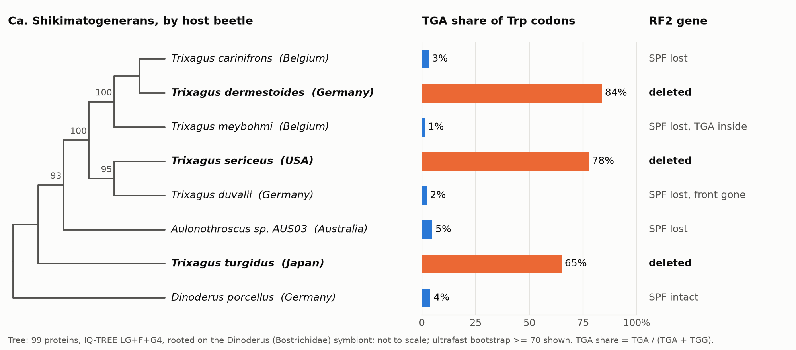

# Beetle symbionts that read TGA as tryptophan and deleted RF2

Bacteria end their genes at a stop codon: TAA, TAG or TGA. RF2, a release factor, is the protein that stops
translation at TGA. A few bacteria, mostly ones with small genomes such as insect symbionts and *Mycoplasma*, read TGA
as the amino acid tryptophan instead, and have usually lost RF2.

*Candidatus* Shikimatogenerans is a beetle symbiont; in the beetle family Throscidae its genome is 133-168 kb and
12-13% GC. In three *Trixagus* species, ***T. sericeus*** (USA), ***T. dermestoides*** (Germany) and ***T. turgidus***
(Japan), it reads TGA as tryptophan, and **each has deleted RF2**. On a tree of the symbionts the three readers do not
group together, so RF2 was deleted, and TGA spread into tryptophan codons, **at least twice**. GenBank annotates these
genomes with the standard code, so **19-25 genes in each are filed as pseudogenes**.

*The Shikimatogenerans symbionts of seven throscid beetles and a bostrichid outgroup, by host. Left: tree of 99
proteins (IQ-TREE LG+F+G4, not to scale). Middle: TGA as a share of tryptophan codons (TGA + TGG). Right: the RF2
gene. Readers in orange.*

**The genomes are not ours.** All seven throscid symbiont genomes were sequenced and deposited by **J.C. Wierz, H. Malm,
M. Kaltenpoth and T. Engl** (Department of Insect Symbiosis, Max Planck Institute for Chemical
Ecology, Jena; BioProject PRJNA1062330). The GenBank records cite their paper, "Diversity, functionality, and
evolutionary history of bacterial symbionts in false click beetles (Coleoptera, Throscidae)", as **unpublished**.

---

- **AI-generated.** The screen, the analysis and the write-up were done by Claude (Anthropic) agents, run and curated
  by Ryan Xu.
- **Checked by AI, not yet by a human expert.** A separate agent re-ran the code call blind to our results with a
  different method (Codetta). Fresh agents fact-checked the write-up sentence by sentence in three rounds, two more
  later recounted the numbers with their own code, and another searched for prior work.
- **DNA only.** No protein data exist for these symbionts, so TGA = tryptophan rests on conserved positions, raw reads
  and Codetta, not on direct observation. The reads come from the same sequencing the genomes were built from.
- **Exploratory parts.** The read and ortholog checks had pass rules or predictions written before they ran. The RF2
  comparison, the tree and the "at least twice" conclusion were done after looking.
- Corrections and criticism are very welcome: ryan@ryanxu.net.

### What was found

| symbiont (host) | TGA per 1,000 codons | TGA share of Trp codons | RF2 |
|---|---|---|---|
| *T. sericeus* GCA_040210545.2 | 3.4 | 78% | deleted |
| *T. dermestoides* GCA_040211365.2 | 3.94 | 84% | deleted |
| *T. turgidus* GCA_040409785.2 | 2.65 | 65% | deleted |
| four other throscid symbionts (*T. carinifrons*, *T. duvalii*, *T. meybohmi*, *Aulonothroscus*) | 0.06-0.22 | 1.4-4.8% | present, SPF motif lost |
| bostrichid outgroup (*S. bostrichidophilus*) | 0.20 | 4.0% | present, SPF intact |

Recount: [`src/check_numbers.py`](src/check_numbers.py).

### Evidence

- **The screen.** We screened 10,593 genomes that failed GTDB release R232 quality control (8,746 good assemblies
  with low completeness, 1,347 that NCBI excluded for reasons a code change could cause, and 500 at random) for genes
  that keep matching known proteins past a stop codon. No genome flags for TAA or TAG, though synthetic and known
  controls do. 141 read through TGA; 103 belong to groups already known to read it by NCBI lineage, and 33 of the
  other 38 by their closest known relatives. Left: the three *Trixagus* symbionts and one of a weevil.
- **Orthologs.** Where the readers have TGA inside a gene, the matching gene of the *T. carinifrons* symbiont has
  tryptophan at 85-93% of sites, about as often as at their own TGG codons (89-91%).
- **Raw reads** carry TGA at 93-100% of covered sites (107-168 sites per genome).
- **Independent re-check.** A separate agent that had not seen our results ran Codetta, which infers a code from
  conserved protein domains without gene calls, on 15 genomes. It called TGA = tryptophan in all three readers, in a
  *Nardonella* weevil symbiont and in the *Hodgkinia* and *Nasuia* controls, and made no TGA call for the other nine.
- **RF2 is deleted.** RF2 is the only gene present in all four other throscid symbionts and missing from all three
  readers. In the first 4 million read pairs of each reader's sequencing run, none matches the RF2 of any throscid
  symbiont, where 27-206 would be expected from coverage; the same search finds 66 in the *T. carinifrons*
  symbiont's reads. In two readers the genes on either side of RF2 now lie 113 and 124 bp apart; in the third, reads
  do not support 298 bp of the assembled stretch, so its length is unknown. The four other
  throscid symbionts still carry an RF2 gene, but every copy has lost SPF, the three amino acids RF2 uses to
  recognise TGA, and in two the front part of the gene is broken as well. A more distant relative, from a bostrichid
  beetle, keeps an RF2 with SPF.
- **TGA in the relatives.** In the five relatives, only 1 of 34 in-frame TGA codons sits in conserved sequence, inside
  the *T. meybohmi* symbiont's own RF2. Most of the rest sit at gene ends, with a TAA or TAG close behind.
- **At least twice.** On a tree of 99 shared proteins the readers do not group together. The *T. dermestoides*
  symbiont's proteins are 84% identical to those of the *T. carinifrons* and *T. meybohmi* symbionts, against 74.5% and
  65% for the other two readers; the *T. sericeus* symbiont is sister to the one from *T. duvalii*. Forcing the
  readers into one group makes the tree far worse (AU test, p < 1e-10), also under a second model (LG+C20), which is
  a weak second check.
- **GenBank and GTDB.** All three records use the standard bacterial code, and NCBI's pipeline files 19-25 genes per
  genome (11-14%) as pseudogenes with internal stops, against none in the *T. carinifrons* symbiont. All seven throscid
  symbionts fail GTDB's marker check, readers or not (22-26% vs 36-37%), so the code is not why GTDB rejected them.

### What was known

- **TGA as a sense codon** is known in *Mycoplasma* and relatives, in Gracilibacteria-related lineages (as glycine),
  in Minisyncoccia (gTranslate 2026), in Eggerthellaceae gut bacteria, in a handful of insect symbionts, and in
  symbionts of ciliates and dinoflagellates. Choi et al. 2026 (*ISME J*) list six animal endosymbionts that read it as
  tryptophan; only one, *Cerorastrobacter*, is in the Bacteroidota, the phylum of Shikimatogenerans.
- **The closest prior work: Parks et al. 2026** (*Microb Genom*, doi:10.1099/mgen.0.001767). In Eggerthellaceae gut
  bacteria they found TGA read as tryptophan, RF2 lost, and the change made at least twice, with a lineage that still
  stops at TGA between the readers. They also note that other symbionts that read TGA as tryptophan fail GTDB's quality control on
  marker genes. gTranslate 2026 found standard-code genomes nested among TGA readers in a Minisyncoccia genus. So a
  patchy code within one group is not new; the *Trixagus* symbionts are another case.
- **These genomes.** NCBI lists the standard code for them. We found no report of a code change in Shikimatogenerans
  or *Nardonella*, and no published version of the Jena group's paper.

### Open points

- **How TGA is read.** All eight symbionts have one tryptophan tRNA, with the usual CCA anticodon and the same
  anticodon loop. The Eggerthellaceae readers carry a tRNA with a UCA anticodon; these do not.
- **The order of events.** All four relatives' RF2 copies have lost SPF, so a common ancestor's RF2 may already have
  recognised TGA poorly, and tryptophan reading could have begun once, before each line deleted RF2. "At least twice"
  covers the RF2 deletions and the spread of TGA, not necessarily the start of TGA reading.
- **The *T. turgidus* symbiont** sits on a long branch, and its place is not settled; the "at least twice" claim
  does not depend on it.
- **The weevil symbiont is weaker.** In *Nardonella* from *Metamasius hemipterus* (GCA_023651715.1), no RF2 is found
  and Codetta called TGA tryptophan, but the genome is a Nanopore draft and Illumina reads cover only 25 of its 141 TGA
  sites (all 25 carry TGA). It stays a candidate.
- **The test's limit.** Fragmented or frameshift-rich assemblies can hide a code from the read-through test: nine
  known TGA readers missed the bar and show up only as near-misses.

### What would settle it

Proteins. Peptides from these symbionts, read by mass spectrometry, would show whether TGA puts tryptophan into the
proteins. The Jena group holds the samples.

### Files

- `notes.md`: the agents' full write-up (screen, controls, checks, the RF2 and tree analyses, references)
- `figures/`: the figure above
- `data/`: the screen tables, the per-symbiont codon, ortholog, read and Codetta tables, the tree and AU tests, the
  RF2 read scan, and the check reports; see [`data/README.md`](data/README.md)
- `src/`: the code; see [`src/README.md`](src/README.md). `uv run python -I src/check_numbers.py` recounts the numbers
  above from `data/`, and `uv run python -I src/throscid_figure.py data/throscidae/concat.faa.treefile out.png` draws
  the figure. The screen itself streams genomes from NCBI and needs code from the lab's other projects (copied to
  `src/lab_deps/`).
