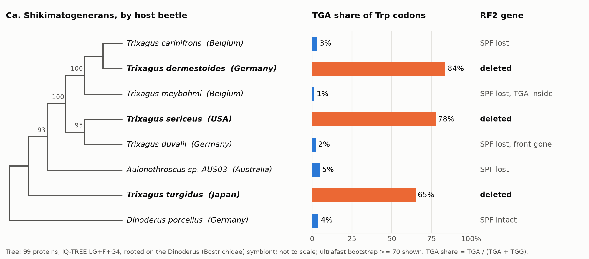

# Notes: beetle symbionts that read TGA as tryptophan and deleted RF2

The agents' full write-up (screen, evidence, checks, open points). The short version is in [`README.md`](README.md).
Times are US Eastern, November 2026. File paths are in this folder; the project's working notes, which these follow,
were kept in the lab's working tree (`work/qc-rejected-codes/README.md`), and the check reports in `data/checks/` refer
to paths there (`results/...` there is `data/...` here).

**Summary.** The bacterial symbionts of three *Trixagus* beetles read the stop codon TGA as tryptophan, and each has
deleted RF2, the release factor that ends genes at TGA. GenBank annotates these genomes with the standard code, so
19-25 genes in each are filed as pseudogenes. **The genomes were sequenced by Wierz, Malm, Kaltenpoth and Engl (Max
Planck Institute for Chemical Ecology, Jena); their paper on these symbionts is listed as unpublished in the GenBank
records.** No protein data exist.

## Background

Bacteria end their genes at TAA, TAG or TGA. A few bacteria, mostly ones with small genomes such as insect symbionts
and *Mycoplasma*, read TGA as the amino acid tryptophan instead, and have usually lost RF2. Recent screens for such
code changes run on the genomes GTDB curates; an earlier screen not tied to GTDB (Shulgina & Eddy 2021) took about
250,000 GenBank assemblies, but predates the genomes below. GTDB rejects genomes whose marker genes look incomplete,
and a genome that reads a stop as an amino acid can look less complete than it is if its genes are called with the
standard code. GTDB's tools already switch to the TGA-as-tryptophan code when that clearly raises coding density, so
this was a check more than a likely gap. We screened the genomes GTDB had rejected.

## The screen

- **Genomes.** 10,593 genomes that failed GTDB release R232 quality control (`data/screen/tier*.txt`): 8,746 good
  assemblies with low completeness, 1,347 that NCBI excluded for reasons a code change could cause ("many
  frameshifted proteins", "missing tRNA genes" and similar), and 500 at random. Tiers, test and pass bar were written
  down before scoring, with controls that had to pass first (`data/screen/controls.txt`).
- **Test.** Whether genes keep matching known proteins past a stop codon (pyrodigal gene calls, in-frame extension
  through the stop, DIAMOND against Swiss-Prot; `src/screen.py`, `src/rank.py`, with `src/lab_deps/readthrough.py`).
- **No TAA or TAG.** No genome flags for TAA or TAG, though synthetic and known controls run through the same
  pipeline do (`data/screen/rank_final.txt`).
- **TGA.** 141 genomes read through TGA. By NCBI lineage, 103 belong to groups already known to read it: *Hodgkinia*,
  *Nasuia*, *Mycoplasma* and relatives, a ciliate symbiont (*Pinguicoccus*), and Gracilibacteria and
  Absconditabacteria (which read TGA as glycine) (`data/screen/labels.tsv`). Matching the other 38 to their closest
  known relatives put 33 in known groups too (`data/screen/placement.tsv`, `tga_meaning.tsv`). One "*Chlamydia*"
  assembly from a cervical sample reads through TGA only in contaminating *Mycoplasma*-like DNA. Left: three symbionts
  of *Trixagus* beetles and one of a weevil.

## The *Trixagus* symbionts

*Candidatus* Shikimatogenerans is a beetle symbiont; in the beetle family Throscidae its genome is 133-168 kb and
12-13% GC. In three *Trixagus* species (*T. sericeus* from the USA, *T. dermestoides* from Germany, *T. turgidus* from
Japan), it reads TGA as tryptophan:

- **Usage.** TGA appears 2.65-3.94 times per 1,000 codons inside genes and makes up 65-84% of all tryptophan codons
  (TGA + TGG). In the symbionts of four other throscid beetles, TGA makes up 1.4-4.8%
  (`data/symbionts/symbiont_profile.tsv`; recounted independently in `data/checks/recheck_mintaka.md`).
- **Orthologs.** Where these genomes have TGA inside a gene, the matching gene of a related symbiont (from
  *T. carinifrons*) has tryptophan at 85-93% of sites, about as often as at their own TGG codons (89-91%)
  (`data/symbionts/ortholog_tga/`, `src/ortholog_tga.py`; prediction written before it ran).
- **Raw reads** carry TGA at 93-100% of covered sites (107-168 sites per genome) (`data/symbionts/read_support/`,
  `src/read_support_tga.py`; numeric pass rule set before it ran).
- **An independent re-check.** A separate agent, which had not seen our results, ran Codetta on 15 genomes given by
  accession. Codetta infers a genome's code from conserved protein domains, with no gene calls, and makes its call
  automatically. It called TGA = tryptophan in all three, in a *Nardonella* weevil symbiont and in the *Hodgkinia* and
  *Nasuia* controls. It made no TGA call for the other nine, the relatives below among them
  (`data/symbionts/codetta/`, `src/codetta_check.py`).
- **Release factor 2.** RF2 is the only gene present in all four of the other throscid symbionts and missing from all
  three readers (`data/throscidae/gene_content.tsv`, `src/gene_content.py`). In each reader it is deleted outright. In
  the first 4 million read pairs of each reader's raw sequencing data, none matches the RF2 of any throscid symbiont,
  where 27-206 would be expected from coverage; the same search finds 66 in the *T. carinifrons* symbiont's reads
  (`data/rf2_readscan/summary.txt`). (125 *T. turgidus* reads match the bostrichid symbiont's RF2 best, but only at
  about 45% identity and with 25% GC against the genome's 13%, so they come from another bacterium in the sample.) In
  two readers the genes on either side of RF2 now lie 113 and 124 bp apart; in the third, reads do not support 298 bp
  of the assembled stretch, so its length is unknown. The four other symbionts still carry an RF2 gene, but every copy
  has lost the SPF motif, the three amino acids RF2 uses to recognise TGA, and in two the front part of the gene is
  broken as well. A more distant relative, from a bostrichid beetle, keeps an RF2 with SPF.
- **TGA in the relatives.** In those five relatives, only 1 of 34 in-frame TGA codons sits in conserved sequence. It
  is inside the *T. meybohmi* symbiont's own RF2, where it breaks the gene under the standard code. Most of the rest
  sit at gene ends, with a TAA or TAG close behind (`data/throscidae/tga_sites.tsv`, `src/throscid_trp.py`).
- **At least twice.** On a tree of 99 proteins shared by these symbionts, the three readers do not group together.
  The *T. dermestoides* symbiont sits among non-readers: its proteins are 84% identical to those of the
  *T. carinifrons* and *T. meybohmi* symbionts, against 74.5% and 65% for the other two readers. On the tree, the
  *T. sericeus* symbiont is sister to the one from *T. duvalii*. Forcing the readers into one group makes the tree far
  worse (AU test, p < 1e-10), also under a second model that lets amino-acid preferences vary across sites (LG+C20),
  though the fitted model puts 93% of its weight on the first model's profile, so it is a weak second check
  (`data/throscidae/`, `src/throscidae_tree.py`). So RF2 was deleted at least twice, and TGA spread into tryptophan
  codons at least twice: the four relatives use it for at most 4.8% of theirs.
- **GenBank.** All three records, and NCBI's taxonomy for them, use the standard bacterial code, which turns every
  in-frame TGA into a stop. NCBI's pipeline files 19-25 genes per genome (11-14%) as pseudogenes with internal stops,
  against none in the *T. carinifrons* symbiont (`data/checks/recheck_sabik.md`).
- **GTDB.** All seven throscid symbionts fail GTDB's quality control on marker genes. The readers score lower
  (22-26% vs 36-37%), but their standard-code relatives fail too (`data/screen/qc_failed_throscid.tsv`). So the code is
  not why GTDB rejected them: these tiny genomes fail its marker check anyway, as Parks et al. 2026 note for other
  symbionts that read TGA as tryptophan.

## The weevil symbiont is weaker

In *Nardonella* from the weevil *Metamasius hemipterus* (GCA_023651715.1), no RF2 is found, and the Codetta re-check
called its TGA tryptophan. At its TGA sites a related *Nardonella* has tryptophan 72% of the time (70% at its TGG
sites). But its genome is a Nanopore draft of 26 contigs in 7 scaffolds, with low coding density, and the Illumina
reads, which were also used to polish it, cover only 25 of its 141 TGA sites (all 25 carry TGA). It stays a
candidate.

## Known before

- **TGA as a sense codon** is known in *Mycoplasma* and its relatives, in Gracilibacteria-related lineages (as
  glycine), in Minisyncoccia (gTranslate 2026), in Eggerthellaceae gut bacteria, in a handful of insect symbionts, and
  in symbionts of ciliates and dinoflagellates. Choi et al. 2026 (*ISME J*) list six animal endosymbionts that read it
  as tryptophan: *Cerorastrobacter*, *Hodgkinia*, *Nasuia*, *Zinderia*, *Stammera* and *Providencia*. Of these, only
  *Cerorastrobacter* is in the phylum Bacteroidota, the phylum of Shikimatogenerans.
- **Repeated change.** Parks et al. 2026 (*Microb Genom*) made the same argument for Eggerthellaceae: TGA read as
  tryptophan, RF2 lost, and the change made at least twice, with a lineage that still stops at TGA between the
  readers. gTranslate 2026 found standard-code genomes nested among TGA readers in a Minisyncoccia genus, and a basal
  standard-code lineage in *Stammera*, a tortoise-beetle symbiont. So a patchy code within one group is not new; the
  *Trixagus* symbionts are another case.
- **These genomes.** Wierz, Malm, Kaltenpoth and Engl (Max Planck Institute for Chemical Ecology) sequenced them
  (BioProject PRJNA1062330). Their paper on throscid symbionts ("Diversity, functionality, and evolutionary history of
  bacterial symbionts in false click beetles (Coleoptera, Throscidae)") is listed as unpublished in the GenBank
  records, and a 2025 conference abstract on the work does not mention the code (a later prior-art agent could not
  find that abstract; `data/checks/priorart_altair.md`). We found no report of a code change in Shikimatogenerans or
  *Nardonella*.

## Method and checks

- **Fixed in advance.** Tiers, test and pass bar were written down before scoring, with controls that had to pass
  first. For the *Trixagus* genomes, the read check had a numeric pass rule and the ortholog check a written
  prediction, both set before they ran; the Codetta re-check used the tool's own call rule.
- **Done afterwards, without pass rules:** the matching of the 38 (whose controls were fixed first), the RF2
  comparison and its read check, the TGA-site and tRNA comparisons, the protein-identity check and the tree. The tree
  test's pass rule was written before it ran, but after the tree itself had shown the readers apart
  (`data/throscidae/au/CRITERION.txt`, `data/throscidae/c20au/CRITERION.txt`).
- **Fact-checks** (`data/checks/factcheck1.md` to `factcheck3.md`). A fresh agent checked every sentence of an earlier
  draft and found 25 problems; a second checked the next draft and found 20 more; a third checked the revised
  sentences and found 9 more. All are fixed. They included Parks et al. 2026, which the project had missed, the two
  broken RF2 genes in the relatives, and a mislabelled C20 tree. The second also scanned each reader's raw reads for
  RF2 (`data/rf2_readscan/`, `src/rf2_readscan/`).
- **Later rechecks** (20 Nov): one agent recounted codon usage with its own gene calls (`data/checks/recheck_mintaka.md`),
  another the pseudogene counts and the RF2 annotation from the GenBank files (`data/checks/recheck_sabik.md`).
  A prior-art agent re-ran the literature search (`data/checks/priorart_altair.md`). The roundup tweet was checked line
  by line (`data/checks/tweet_check.md`).

## Not known

- **How TGA is read.** All eight symbionts have one tryptophan tRNA, with the usual CCA anticodon and the same
  anticodon loop (`data/throscidae/trna_trp.txt`). The Eggerthellaceae readers carry a tRNA with a UCA anticodon;
  these do not, and nor do *Zinderia*, *Stammera* or *Providencia* (Choi et al. 2026). No public protein data exist.
- **Whether the relatives' RF2 still works.** Every copy has lost SPF, and two are broken at the front.
- **The order of events.** Whether RF2 went first and TGA filled in, or TGA was being read before RF2 went, these
  genomes cannot say. All four relatives' RF2 copies have lost SPF, so a common ancestor's RF2 may already have
  recognised TGA poorly, and tryptophan reading could have begun once, before each line deleted RF2. Parks et al.
  tested that idea through the gene order around a UCA tRNA; these symbionts have none, so that test cannot be run
  here.
- **The *T. turgidus* symbiont.** It sits on a long branch, and its place is not settled: the LG tree puts it outside
  *Aulonothroscus* (bootstrap 93), and the C20 search reached that tree's likelihood before it was stopped, but under
  C20 the AU test does not reject it as sister to the other *Trixagus* (p 0.11; that tree was not tested under LG).
  Either placement would make it a third, separate loss, but that rests on the tree alone.
- **The test's limit.** Fragmented or frameshift-rich assemblies can hide a code from this test: nine known TGA
  readers missed the bar and show up only as near-misses.

## Risks noted before posting

- The genomes belong to the Jena group, whose paper on them is listed as unpublished. The BioSamples already carry a
  proposed species name ("Shikimatogenerans throscidiphilus"), so the paper may be far along, and they may well have
  noticed the code. The project recommended writing to them before posting.
- The reads come from the same sequencing the genomes were built from, so read support is partly built in; the
  ortholog and Codetta checks do not share that weakness.
- 6 of the 8 sequences fail IQ-TREE's composition test, which the tree models do not handle. The "at least twice"
  claim also rests on raw protein identity (84% vs at most 74.5%), which needs no model.
- An early RF2 profile wrongly called RF2 absent in the non-readers (cutoff too strict), and an early draft suggested
  their lost SPF explained their rare TGA. Both were corrected, but they show the RF2 story was built after looking.

## References

- Choi et al. 2026. *ISME J*. doi:10.1093/ismejo/wrag259.
- Chaumeil et al. 2026 (gTranslate). *PeerJ*. doi:10.7717/peerj.21825.
- Palmieri, Pavarini & Sharma 2022. *Microbiol Resour Announc*. PMC9670985. (The *Nardonella* NARMHE1 genome.)
- Parks, Chaumeil, Chuvochina & Hugenholtz 2026. *Microb Genom*. doi:10.1099/mgen.0.001767. PMC13462651.
- Shulgina & Eddy 2021. *eLife* (Codetta).
- Wierz, Malm, Kaltenpoth & Engl. "Diversity, functionality, and evolutionary history of bacterial symbionts in false
  click beetles (Coleoptera, Throscidae)". Unpublished (cited in GenBank CP157893.2 and the other records of
  BioProject PRJNA1062330).
