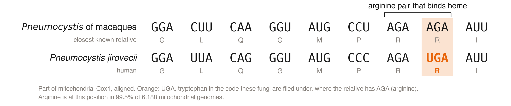

# A fungus whose mitochondria read UGA as arginine

Genes are read three bases (one codon) at a time. In the standard genetic code UGA is a stop codon. Many mitochondria
read a few codons differently, and in the mitochondria of most fungi UGA means tryptophan (NCBI's table 4).

In the mitochondria of *Pneumocystis jirovecii*, the fungus that causes pneumocystis pneumonia in people with weak
immune systems, UGA sits where related proteins have **arginine**, not tryptophan. We aligned the proteins of about
22,700 mitochondrial genomes and asked which amino acid usually stands at each position where *P. jirovecii* has UGA.
The genome has UGA at 23 positions where at least 90% of mitochondrial genomes have arginine, and at none of the 37
positions where they have tryptophan (there it uses UGG). Patient RNA carries UGA at these sites, so the RNA is not
edited into an arginine codon. UGA most likely means arginine here. None of NCBI's genetic codes reads UGA as arginine,
and as far as we can find this is the first such case in fungi (it has been proposed in a few other lineages; see
below).

*Part of the mitochondrial protein Cox1, aligned, at the arginine pair that binds heme. Amino acids below each codon
are read with the mold mitochondrial code (NCBI table 4), except UGA, shown as arginine in* P. jirovecii. *Arginine is
at this position in 99.5% of 6,188 mitochondrial genomes. The codons at all conserved arginine positions of the 9
species are in [`notes.md`](notes.md).*

---

- **AI-generated.** The census, the analysis and the write-up were done by Claude (Anthropic) agents, run and curated
  by Ryan Xu.
- **Checked by AI, not yet by a human expert.** A separate agent was given 10 coded genomes and asked to infer each
  one's code with two methods, without being told which were expected to differ (it called UGA = arginine in
  *P. jirovecii* and the usual code in two *Pneumocystis* controls). Further agents re-derived every census and RNA
  number with their own code before posting, and checked every citation (three of them from the abstract only).
- **Computational only.** No protein data exist to show arginine in the proteins themselves.
- Corrections and criticism are very welcome: ryan@ryanxu.net.

### What was found

| | UGA at conserved Arg positions | UGA at conserved Trp positions |
|---|---|---|
| *P. jirovecii* reference genome (NC_020331) | 23 | 0 (Trp is UGG at 37) |
| 18 more *P. jirovecii* isolates, at the 32 Arg-position UGA sites | 564 of 576 codons UGA; the other 12 are AGA (Arg), all at one site | |
| the other 8 *Pneumocystis* species, at the same 23 positions | 4 of 184 (3 *P. carinii*, 1 *P. murina*); 179 Arg codons, 1 Lys | 0 |
| patient lung-wash RNA (10 runs), at the 32 sites | 7,109 of 7,298 reads UGA (97.4%), 3 CGA | |

"Conserved" = one amino acid at ≥ 90% of aligned mitochondrial genomes, each genome weighted by 1/(genomes in its
family). At those 23 positions, 94–99.9% of about 4,200–6,500 genomes have arginine. Of the 36 UGA codons of
*P. jirovecii* that fall in aligned protein regions, 32 are at positions where arginine is the most common amino acid.

### Evidence

- **Positions.** UGA at 23 conserved arginine positions and 0 conserved tryptophan positions. One sits at the
  heme-binding arginine pair of cox1, arginine in 99.5% of 6,188 genomes.
- **Isolates.** 18 more *P. jirovecii* mitochondrial genomes (patients in the US, Europe and China, all sequenced by
  one NIH group) carry UGA at 564 of 576 of these sites. The 12 exceptions are AGA, an arginine codon, all at one site.
- **UGA and arginine codons swap like synonyms.** At that site (nad2 codon 282) the reference has UGA and 12 of 18
  isolates have AGA. At another (nad1 codon 33, arginine in 99% of genomes), the reference has CGA, 6 of 18 isolates
  have UGA, and the patient RNA reads UGA in 41 of 41 reads.
- **No RNA editing.** In RNA from one patient's lung wash (ENA PRJEB3063, 10 runs), 97.4% of reads at the 32 sites read
  UGA and 3 read CGA. The patient's strain has AGA at nad2:282 (129 of 130 reads); without that site 99.2% read UGA.
  Hornwort and fern organelles edit this very codon (UGA to CGA); *Pneumocystis* does not. Rat *P. carinii* RNA
  (SRR2156857): its 4 Arg-position UGA sites read UGA in 50 of 50 reads.
- **Blinded re-check.** A separate agent, given 10 coded genomes and two methods (Codetta and its own ortholog
  columns), called UGA = arginine in *P. jirovecii* (arginine at 26 of 29 conserved positions; p 2e-13 against
  tryptophan) and the usual table 4 in *P. murina* and *P. wakefieldiae*. The rule for passing was fixed before it
  started.
- **The tRNA.** The genome has no tRNA with anticodon UCA, which would read UGA as tryptophan (noted by Ma et al.
  2013, who sequenced it).

### What was known

- **UGA in *Pneumocystis*.** NCBI Taxonomy files these fungi under table 4 (UGA = tryptophan).
  [Ma et al. 2013](https://pmc.ncbi.nlm.nih.gov/articles/PMC3633818/) (*FASEB J.* 27:1962), who sequenced the *P. jirovecii*,
  *P. carinii* and *P. murina* mitochondrial genomes, read UGA as tryptophan, noted the missing UCA tRNA and suggested
  that the tRNA-Trp with anticodon CCA is modified to read UGA. We found no report of UGA = arginine or of RNA editing
  in *Pneumocystis*.
- **UGA = arginine elsewhere.** Proposed for the mitochondrion of the diatom *Craticula vanensis* ([Yılmaz et al. 2026](https://doi.org/10.1038/s41598-026-62093-2),
  *Sci. Rep.*), the nuclear genomes of seven spirotrich ciliates ([Chen et al. 2023](https://pmc.ncbi.nlm.nih.gov/articles/PMC10089648/), *Mol. Biol. Evol.*; a 2025 review,
  [Lukeš et al.](https://doi.org/10.1016/j.cub.2025.09.071), *Curr. Biol.*, calls some of these cases spurious) and of the ciliate *Licnophora* and relatives
  (Maturová, Žárský & Eliáš, bioRxiv, November 2026). Suggested for the plastids of Trentepohliales green algae (Fang
  et al. 2021, *Front. Plant Sci.*) and, from 3 codons, the mitochondrion of a tunicate (Pichon et al. 2019,
  *F1000Research*). So this would be the first case in fungi, not the first anywhere.

### Open points

- **No protein evidence.** We found no *Pneumocystis* proteome in PRIDE, MassIVE or the other ProteomeXchange
  archives, and the three published *Pneumocystis* proteomics studies we found report no mitochondrially encoded
  protein. A modified
  tRNA-Trp reading UGA (Ma et al.'s idea) would put tryptophan at these 23 arginine positions. That has a precedent:
  *Leishmania* mitochondria edit their tRNA-Trp anticodon to read UGA as tryptophan (Alfonzo et al. 1999). The
  positions argue against it, but only peptides can rule it out.
- **Which tRNA reads UGA** is not known. The genome has a tRNA-Arg with anticodon UCG; a modified wheat tRNA-Arg of
  this kind reads UGA in vitro (Baum & Beier 1998).
- **The other species.** *P. carinii* (4 sites) and *P. murina* (1) have too few to call a code. The macaque species,
  the closest relative of *P. jirovecii* in published trees (Cissé et al. 2021, *Commun. Biol.*), has none, so most of
  the 23 sites most likely changed in the *P. jirovecii* lineage. We did not build a tree.
- **One source for the isolates.** All 18 isolate genomes come from one group; the patient RNA (Lausanne) and the
  within-species swaps are the independent part.

### What would settle it

Peptides. Mitochondrial proteins of *P. jirovecii*, for example from patient lung-wash samples, read by mass
spectrometry would show arginine or tryptophan at these positions.

### Files

- `notes.md`: the agents' full write-up (method, checks, numbers, references)
- `figures/`: the figure above (`uga_arg_rows.png`) and the codons at conserved arginine positions in 9 *Pneumocystis*
  genomes (`pneumo_uga_arg.png`, in `notes.md`)
- `data/`: the per-site codon tables, per-run RNA tallies, the blinded re-check and the fact-checks; see
  [`data/README.md`](data/README.md)
- `src/`: the code; see [`src/README.md`](src/README.md). `uv run python -I src/fig_uga_arg_rows.py out.png` draws the
  figure above from `data/genomes/`. The census itself needs files not included here (about 22,700 genomes).
