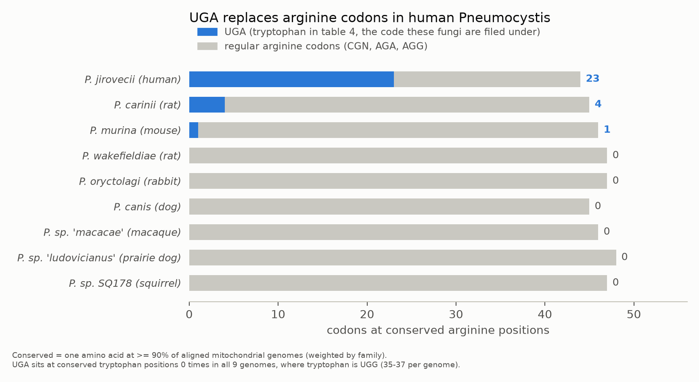

# Notes: *Pneumocystis jirovecii* mitochondria read UGA as arginine

The agents' full write-up (method, checks, numbers). The short version is in [`README.md`](README.md). Times are US
Eastern, November 2026.

**Summary.** In the mitochondrial genome of *P. jirovecii* (NC_020331.1), UGA stands at 23 positions where at least
90% of mitochondrial genomes have arginine and at none of the 37 where they have tryptophan. 18 more isolates and the
RNA of one patient agree. UGA most likely means arginine. No protein data exist.

## Method
1. **Census.** About 22,700 mitochondrial genomes (all of RefSeq plus one per additional species from GenBank) were
   translated with their declared codes, and every protein was aligned to profile HMMs (pyhmmer; `src/codes_census/census_org.py`,
   `src/codes_census/scan_org.py`). For each profile column, the residue frequencies over all genomes were tallied, each
   genome weighted 1/(genomes in its family). A column is *strict* if one residue has ≥ 90% of the weight
   (`src/codes_census/sitescan_org.py`).
2. **Scan.** An all-columns scan asked, for every codon in every genome, which residue's columns the codon sits in
   (`src/codes_census/profile_scan.py`). In NC_020331.1 UGA fits arginine's columns better than tryptophan's.
3. **Positions** (`src/tga_arg/pneumo_cols.py` → `data/sites/pneumo_cols.tsv`, per genome). In *P. jirovecii*: UGA at
   23 strict-Arg columns, 0 strict-Trp columns; 32 of its 36 placed UGA codons are at Arg-majority columns. CGA, the
   codon one U→C edit would give, is nearly unused (9 sites). At the 23 positions, 94–99.9% of about 4,200–6,500
   genomes have arginine.
4. **Other *Pneumocystis* species at the same columns** (`src/tga_arg/pneumo_same_cols.py` →
   `data/sites/pneumo_same_cols.tsv`): the other 8 genomes have an Arg codon 179 of 184 times (AGA 113, CGA 48, CGT 9,
   AGG 5, CGG 4), UGA 4 (3 *P. carinii*, 1 *P. murina*), AAA 1, UGG 0. Every fungus outside *Pneumocystis* has 0 or 1
   UGA at strict-Arg columns.
5. **Isolates** (`src/tga_arg/isolates.py` → `data/sites/isolates.tsv`). 18 more *P. jirovecii* mitogenomes (GenBank
   JX855936–8, MH010437–46, MT319762, MW530525–8; all from the Kovacs/Ma group at NIH). JX499143 is the reference
   itself (NC_020331's COMMENT says "identical to JX499143") and is not counted. A whole-genome minimap2 alignment
   (asm20) gives UGA at 564 of 576 site-isolate pairs and AGA at 12, all at nad2 codon 282. A second swap: nad1
   codon 33 (strict Arg, share 0.99) is CGA in the reference and 12 isolates and UGA in 6.
6. **RNA** (`src/tga_arg/tally_rna.py` on reads mapped by `src/codes_census/reads_codons.py` with MIN_MAPQ=0 MAX_DIV=0.05: no MAPQ filter, reads with > 5%
   mismatches dropped; per-run tables in `data/rna/`, summed in `data/rna/summary.txt`). Total RNA from one patient's
   lung wash (ENA PRJEB3063, runs ERR135872–81). At the 32 UGA sites at Arg-consensus columns, 7,109 of 7,298 reads
   (97.4%) read UGA and 3 read CGA. nad2:282 reads AGA in 129 of 130 reads in every run, a polymorphism of this
   patient's strain; without it 99.2% read UGA (strict sites alone: 5,028 of 5,063). Background: UGG sites 98.0% UGG,
   CGU sites 99.1% CGU. nad1:33 reads UGA in 41 of 41. *P. carinii* (NC_013660.2, rat RNA SRR2156857): its 4 strict-Arg
   UGA sites read UGA in 50 of 50 reads.
7. **tRNA.** No tRNA with anticodon UCA in the genome (Ma et al. 2013 noted this). There is a tRNA-Arg with anticodon
   UCG.
8. **CUN check.** Ma et al. 2013 report an extra tRNA-Thr with anticodon UAG in *P. jirovecii*, which could read CUN as
   threonine (as in yeast mitochondria). In all 9 *Pneumocystis* mitogenomes, CUN codons at well-conserved columns
   face leucine 30 of 30 times (1 to 6 per genome), as UUA/UUG do (100 of 100): no sign of CUN = Thr
   (`src/pneumo_cun.py` → `data/sites/pneumo_cun.tsv`). Small counts; checked by one agent only.

*Codons at conserved arginine positions in the mitochondrial genomes of 9* Pneumocystis *species
(`data/sites/pneumo_cols.tsv`, drawn by `src/tga_arg/fig_pneumo.py`). UGA (blue) stands in for arginine codons mainly
in the human species.*

## Checks
- **Blinded panel** (`data/checks/blinded_panel.md`, 11 Nov). A fresh agent got 10 coded genomes, no annotation, and
  was told only to infer each genome's mitochondrial code, with Codetta v2.0 and its own ortholog-column tally against
  79 annotated reference mitogenomes. The pass rule was fixed at 14:36, before launch. It called UGA = Arg in
  *P. jirovecii* (Codetta R; columns R 26 of 29, p 2e-13) and in the diatom *Craticula*; *P. murina*,
  *P. wakefieldiae* and three diatoms got table 4. *P. carinii* UGA was R at 4 of 4 columns, too few to call. PASS.
- **Pre-post check** (11 Nov, a fresh agent with its own code). It re-derived every census and RNA number, found the
  call not circular (the same 23 positions come out with all *Pneumocystis* left out of the column consensus) and UGA
  never a stop or frameshift. It corrected the isolate count (18, not 19; one "isolate" was the reference), CGA 3 not
  4, and the wording. It placed one UGA at cox1's MPRR arginine pair (cow R438/R439, which bind the heme propionates;
  99.5% Arg across 6,188 genomes).
- **Prior art** (11 Nov, 13 Nov, 20 Nov; fresh agents). The 20 Nov check opened all 10 citations and quoted them, and
  searched Europe PMC (with preprints), two web searches, the NCBI code tables and the Lukeš 2025 review with its
  Table S2. It found no report of a fungal UGA = Arg and no *Pneumocystis* proteome in ProteomeXchange.

## Open points
See README. Mainly: no protein evidence, so a modified tRNA-Trp reading UGA cannot be excluded; the reader tRNA is
unknown; all isolates come from one group; "changed in the *P. jirovecii* lineage" rests on published trees.

## References
- Alfonzo JD et al. 1999. *EMBO J* 18:7056. PMC1171768. (*Leishmania* mitochondrial tRNA-Trp anticodon edited to read UGA.)
- Baum M, Beier H 1998. *Nucleic Acids Res* 26:1390. PMC147420. (Wheat tRNA-Arg(U\*CG) suppresses UGA in vitro.)
- Chen W et al. 2023. *Mol Biol Evol* 40:msad064. PMC10089648.
- Cissé OH et al. 2021. *Commun Biol* 4:305. PMC7940399.
- Fang J et al. 2021. *Front Plant Sci* 12:780054. PMC8692980.
- Lukeš J et al. 2025. *Curr Biol* 35:R1104. doi:10.1016/j.cub.2025.09.071.
- Ma L et al. 2013. *FASEB J* 27:1962. PMC3633818.
- Maturová, Žárský & Eliáš 2026. bioRxiv doi:10.64898/2026.11.04.764322 (abstract read only).
- Pichon J, Luscombe NM, Plessy C 2019. *F1000Research* 8:2072. PMC7047913.
- Yılmaz E et al. 2026. *Sci Rep*. doi:10.1038/s41598-026-62093-2.
